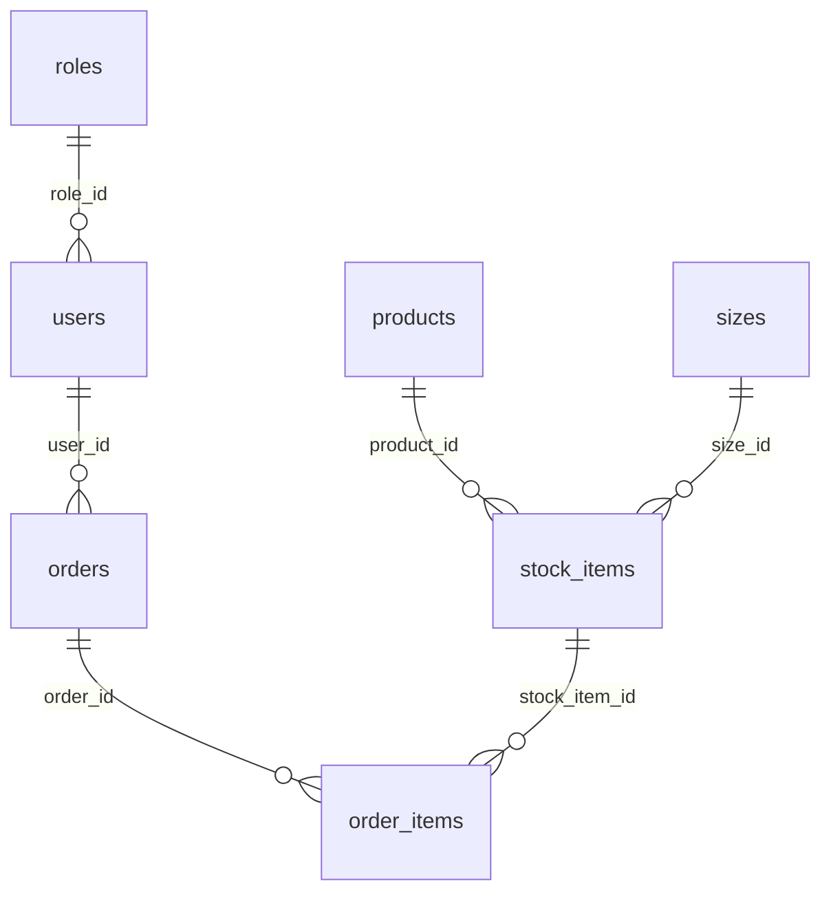

# Чудо Обувь: учебник с нуля, со всем кодом

**Python + Tkinter/ttk + PostgreSQL + pgAdmin. Школьная М ОС Linux.** Обновлено 13 октября 2026 года.

Здесь есть полный исходный код приложения, SQL, импорт пяти Excel, начальные упражнения и объяснение каждого этапа. От тебя не предполагается знание Python или SQL. Блоки «Полный файл» надо целиком записывать в указанный файл: в них нет пропущенных обработчиков и просьб самостоятельно придумать оставшуюся реализацию.

Рядом уже лежит готовая папка `training_project`. Её можно запустить и изучить сейчас. Это учебный пример. На экзамене ты создаёшь свой проект, пишешь файлы и используешь изображения и Excel, выданные организаторами. Инструкция не требует приносить мой проект, `exam_support`, проверочные скрипты или другие заготовки. Возможность пользоваться учебником на экзамене здесь не предполагается.

Ваша договорённость: Python, PostgreSQL, Tkinter/ttk, pgAdmin; Автотеста на пробнике не будет, проверка предположительно ручная. Требования к функциям и результатам взяты из этого КИМ. Конкретный способ передачи результатов задают преподаватели. Модули 1–4 развивают одно приложение последовательно; модуль 5 — отдельные CSV-расчёты. Всего 240 минут, рекомендованные ориентиры — 50 / 40 / 60 / 60 / 30 минут. В тренировке сначала работай без таймера.

Честно: прочитать код один раз и научиться писать его самостоятельно — разные вещи. За семь дней важнее научиться воспроизводить этот конкретный путь и объяснять основные операции, чем пытаться изучить весь Python. Сначала запусти маленькие примеры, затем приложение, затем повтори сборку в новой папке.

## Содержание

1. [Установка и создание папок](#1-установка-и-создание-папок)
2. [Первое окно и карточки](#2-первое-окно-и-карточки)
3. [Основы Python на коде экзамена](#3-основы-python-на-коде-экзамена)
4. [Модуль 1: база, SQL, импорт и ERD](#4-модуль-1-база-sql-импорт-и-erd)
5. [Модуль 2: каталог и полный код приложения](#5-модуль-2-каталог-и-полный-код-приложения)
6. [Модуль 3: вход, поиск, корзина и оформление](#6-модуль-3-вход-поиск-корзина-и-оформление)
7. [Модуль 4: менеджер и администратор](#7-модуль-4-менеджер-и-администратор)
8. [Сохранение базы, README, Git и сдача](#8-сохранение-базы-readme-git-и-сдача)
9. [Модуль 5: аналитика и полный шаблон](#9-модуль-5-аналитика-и-полный-шаблон)
10. [Что делать при ошибках](#10-что-делать-при-ошибках)
11. [Как заниматься семь дней](#11-как-заниматься-семь-дней)
12. [Ручная проверка перед сдачей](#12-ручная-проверка-перед-сдачей)

## 1. Установка и создание папок

### 1.1. Где вводить разные команды

**Команды bash** вводятся в терминале Linux. **SQL** вводится в Query Tool pgAdmin. **Код Python** записывается в файлы `.py` в редакторе. Не вставляй SQL в терминал и не вводи содержимое файла Python как команду bash.

В редакторе файлы сохраняй в UTF-8. Отступы Python — четыре пробела, не смешивай пробелы и табуляцию. В коде обычные кавычки `"` и `'`, а не типографские «ёлочки».

### 1.2. Единственная установка для приложения

На школьном компьютере Python с Tkinter, PostgreSQL и pgAdmin должны быть установлены. В терминале открой удобную рабочую папку и выполни по очереди:

```bash
mkdir chudo_obuv
cd chudo_obuv
python3 -m venv .venv
source .venv/bin/activate
python -m pip install "psycopg[binary]" openpyxl Pillow
```

`mkdir` создаёт папку; `cd` переходит в неё. `venv` создаёт отдельное окружение библиотек для этого проекта. `source` активирует его. Последняя команда устанавливает три нужные библиотеки: psycopg — PostgreSQL, openpyxl — чтение Excel, Pillow — изображения. Это вся установка. Никаких `.in`, `pip freeze` или обязательных скриптов проверки окружения.

В IDE выбери интерпретатор `chudo_obuv/.venv/bin/python`. После открытия нового терминала снова активируй окружение:

```bash
source .venv/bin/activate
```

В дальнейшем команды `python ...` выполняй из папки проекта. [Документация Python о venv](https://docs.python.org/3/library/venv.html).

Создай обычный `requirements.txt` в корне проекта. Это список трёх библиотек для следующего запуска и проверяющего. Если сейчас выполнил установку выше, повторно ставить их не нужно.

### Полный файл `requirements.txt`

```text
psycopg[binary]
openpyxl
Pillow
```

Для готового примера или восстановленного проекта установка того же списка делается одной командой:

```bash
python -m pip install -r requirements.txt
```

Tkinter/ttk — модули стандартной библиотеки Python. В Linux компонент Tkinter может отсутствовать в системной установке. Через pip его не ставят: это вопрос подготовки компьютера с преподавателем. В день подготовки можно открыть `python -m tkinter`: должно появиться окно. Эта проверка необязательна для каждого запуска.

### 1.3. Что создать и что взять из выданных материалов

В редакторе или файловом менеджере создай внутри проекта папки `app`, `data`, `assets`, `assets/products`, `database`, `lessons`.

Из материалов **самого задания** скопируй в `data` пять файлов: `Products_import.xlsx`, `Sizes_import.xlsx`, `Stock_Items_import.xlsx`, `Orders_import.xlsx`, `Users_import.xlsx`. Из папки Images скопируй 31 фото обуви в `assets/products`. Выданный логотип «Чудо Обувь.png» скопируй под именем `assets/logo.png`, заглушку — `assets/picture.png`, выданную ICO-иконку — `assets/app.ico`. Изображения не перерисовывай и не меняй их пропорции.

Итоговая структура после выполнения инструкции:

```text
chudo_obuv/
    main.py
    settings.py
    import_data.py
    requirements.txt
    README.md
    .gitignore
    app/
        __init__.py
        db.py
        common.py
        service.py
        ui.py
    database/
        schema.sql
        check_import.sql
        database_with_data.sql   ← создаётся при сохранении БД
    data/
        Products_import.xlsx
        Sizes_import.xlsx
        Stock_Items_import.xlsx
        Orders_import.xlsx
        Users_import.xlsx
    assets/
        logo.png
        app.ico
        picture.png
        products/
            IMG_...png           ← все выданные фотографии
    lessons/
        01_window.py
        02_cards.py
    ERD_module_1.pdf             ← экспорт схемы при сдаче
    analytics.py                ← отдельный модуль 5
    analytics_data/             ← появится, когда дадут приложение 4
```

`.venv` находится здесь же, но в архив сдачи не входит. `lessons` нужны только для обучения, в экзаменационный проект включать их необязательно. Все обязательные файлы приложения ниже приведены целиком.

### 1.4. Четыре особенности М ОС

1. Имена чувствительны к регистру: `Products_import.xlsx` и `products_import.xlsx` — разные имена.
2. Пути в коде строятся через `pathlib` относительно проекта. Не записывай `C:\...` или `D:\...` в код для школьного Linux.
3. Windows-окружение `.venv` не переносится на Linux. Переносятся исходники, окружение создаётся заново.
4. Calibri требуется по заданию. Убедись в день подготовки, что он доступен; замена шрифта требует договорённости с преподавателем. Название Calibri в коде само по себе шрифт не устанавливает.

На текущем компьютере пример проверен в Windows с настоящим PostgreSQL и Tkinter. Школьную сборку М ОС здесь не запускали, поэтому первый пробный запуск там нужен в день подготовки.

## 2. Первое окно и карточки

Эти упражнения можно выполнить до работы с PostgreSQL. В них видно, что делают `Tk`, `Frame`, `Label`, `Button`, `Canvas` и `Scrollbar`.

### 2.1. Первое окно: запиши и запусти

Создай `lessons/01_window.py`, запиши следующий полный код и сохрани файл.

### Полный файл `lessons/01_window.py`

```python
"""Первое упражнение: окно и кнопка. База данных не нужна."""

import tkinter as tk
from tkinter import ttk, messagebox


def say_hello():
    messagebox.showinfo("Кнопка работает", "Ты нажал кнопку. Это вызвало функцию say_hello.")


window = tk.Tk()
window.title("Чудо Обувь — Первое окно")
window.geometry("600x400")
window.minsize(400, 300)
window.configure(bg="white")

label = ttk.Label(window, text="Моё первое окно на Python", font=("Calibri", 18))
label.pack(pady=30)

button = ttk.Button(window, text="Нажми меня", command=say_hello)
button.pack(pady=10)

window.mainloop()
```

В терминале из корня проекта:

```bash
python lessons/01_window.py
```

Ожидается окно с текстом и кнопкой. Нажатие показывает сообщение. Закрой окно перед переходом к следующему примеру.

Разбираем буквально:

| Строка или конструкция | Что делает |
| --- | --- |
| `import tkinter as tk` | Подключает библиотеку окон и даёт ей короткое имя tk |
| `from tkinter import ttk, messagebox` | Подключает виджеты ttk и стандартные сообщения |
| `def say_hello():` | Создаёт функцию; сейчас её тело не выполняется |
| Отступ перед `messagebox...` | Показывает, что эта строка входит в функцию |
| `window = tk.Tk()` | Создаёт главное окно и сохраняет его в переменную window |
| `title` / `geometry` / `minsize` | Название, начальный и минимальный размер |
| `ttk.Label(window, ...)` | Создаёт надпись внутри window |
| `pack(...)` | Размещает виджет в родительском контейнере |
| `command=say_hello` | Передаёт кнопке функцию, которую она вызовет при нажатии |
| `mainloop()` | Запускает обработку событий: кликов, ввода и закрытия |

**Важная мелочь:** `command=say_hello`, без круглых скобок. `command=say_hello()` вызывает функцию сразу при создании кнопки и передаёт кнопке результат её выполнения. Это частая причина «кнопка не работает, сообщение появляется при запуске».

Мини-задание: поменяй заголовок, надпись и текст сообщения. Добавь вторую кнопку с `command=window.destroy`, которая закроет окно. Если получается без подсматривания, основа понятна.

### 2.2. Прокручиваемые карточки: полный отдельный пример

Создай `lessons/02_cards.py`. Здесь искусственный список из десяти карточек и текст «Фото» вместо изображения: это упражнение на размещение, не итоговый каталог экзамена.

### Полный файл `lessons/02_cards.py`

```python
"""Второе упражнение: прокрутка и карточки. Список здесь учебный, без БД."""

import tkinter as tk
from tkinter import ttk

window = tk.Tk()
window.title("Чудо Обувь — Учебные карточки")
window.geometry("850x550")
window.minsize(650, 400)
window.configure(bg="white")

header = tk.Frame(window, bg="#D2F6E7", padx=15, pady=15)
header.pack(fill="x")
tk.Label(header, text="Чудо Обувь", bg="#D2F6E7", font=("Calibri", 20)).pack(side="left")

area = tk.Frame(window, bg="white")
area.pack(fill="both", expand=True)

canvas = tk.Canvas(area, bg="white", highlightthickness=0)
scrollbar = ttk.Scrollbar(area, orient="vertical", command=canvas.yview)
canvas.configure(yscrollcommand=scrollbar.set)
scrollbar.pack(side="right", fill="y")
canvas.pack(side="left", fill="both", expand=True)

cards_frame = tk.Frame(canvas, bg="white")
window_id = canvas.create_window((0, 0), window=cards_frame, anchor="nw")


def update_scroll(event):
    canvas.configure(scrollregion=canvas.bbox("all"))


def update_width(event):
    canvas.itemconfigure(window_id, width=event.width)


cards_frame.bind("<Configure>", update_scroll)
canvas.bind("<Configure>", update_width)

# Повторяем десять карточек только для упражнения с прокруткой.
for number in range(1, 11):
    color = "#ff8080" if number == 1 else "white"
    card = tk.Frame(cards_frame, bg=color, bd=1, relief="solid", padx=12, pady=12)
    card.pack(fill="x", padx=12, pady=6)
    tk.Label(card, text="Фото", bg="#D2F6E7", width=12, height=5).pack(side="left", padx=10)
    tk.Label(card, text=f"Модель №{number}\nКатегория: Женская обувь\nКоличество: {number}\nСостав: кожа",
             bg=color, justify="left", font=("Calibri", 12)).pack(side="left", padx=10)
    tk.Label(card, text="5 000 ₽", bg=color, font=("Calibri", 16)).pack(side="right", padx=15)

window.mainloop()
```

Запусти:

```bash
python lessons/02_cards.py
```

Ожидаются шапка, карточки и полоса прокрутки. Первая карточка красная. Потяни ползунок, затем измени размер окна. В итоговом приложении появятся реальные изображения, данные из БД и прокрутка колёсиком.

Как устроена вложенность:

```text
window — главное окно
├── header — верхняя полоса
└── area — область списка
    ├── scrollbar — вертикальный ползунок
    └── canvas — прокручиваемая поверхность
        └── cards_frame — контейнер всего списка
            ├── card — первая карточка
            ├── card — вторая карточка
            └── ...
```

Canvas умеет прокручивать свою область. Frame содержит обычные виджеты, но своей прокрутки не имеет. Поэтому Frame с карточками помещён внутрь Canvas через `create_window`. `scrollregion=canvas.bbox("all")` сообщает Canvas размер всего содержимого. Событие `<Configure>` возникает при изменении размеров: один обработчик обновляет область прокрутки, другой растягивает внутренний Frame до ширины Canvas. [Документация Tkinter](https://docs.python.org/3/library/tkinter.html).

`pack(fill="x")` растягивает по ширине; `fill="both", expand=True` занимает свободное место по обеим осям. `side="left"` и `side="right"` раскладывают соседние элементы. `padx` — горизонтальные отступы, `pady` — вертикальные.

**Не смешивай pack и grid у детей одного родителя.** В разных контейнерах их сочетать можно: в итоговом коде экран размещается через pack, а таблица внутри отдельного Frame — через grid.

Мини-задание: создай 20 карточек, поменяй цену и добавь строку «Производство». Пока не разбирай оформление заказа: сначала убедись, что можешь создать и растянуть окно.

## 3. Основы Python на коде экзамена

### 3.1. Переменные, типы, условия и циклы

Пример ниже объясняет синтаксис, его не нужно добавлять в приложение:

```python
name = "Азимут Бег"        # str — текст
quantity = 2              # int — целое число
is_customer = True        # bool — истина или ложь

if quantity <= 3:
    color = "#ff8080"
else:
    color = "white"

for size in [36, 37, 38]:
    print(size)
```

`=` присваивает, `==` сравнивает. `if` выполняет блок, если условие истинно; `else` — другой случай. Двоеточие начинает блок, строки блока имеют отступ. `for` повторяет блок для каждого элемента. `#` начинает комментарий. `print` выводит текст в терминал, не в окно.

`entry.get()` возвращает **строку**, даже если ты ввёл цифру. Поэтому для количества нужна проверка и преобразование: `int("2")` даёт 2, а `int("2.5")` вызовет ошибку. В полном коде эту работу выполняет `parse_quantity`.

Цена используется как `Decimal("1000.00")`, а не float: Decimal хранит десятичную сумму, которой удобнее точно считать копейки. Размер `36.5` тоже должен сохраниться дробным числом. В SQL для обоих используется NUMERIC.

### 3.2. Список, словарь и корзина

```python
products = ["Кроссовки", "Туфли"]
product = {"product_name": "Туфли", "price": 5000}
print(product["product_name"])

cart = {}
cart[17] = {"quantity": 2, "product_name": "Туфли", "size_value": 38}
cart[17]["quantity"] = 3
del cart[17]
```

`[]` создаёт список либо обращается к элементу; `{}` создаёт словарь. В словаре значение ищется по ключу. В нашем приложении ключ корзины — `stock_item_id`, идентификатор **модели конкретного размера**. Два размера одной модели должны попасть в две строки. Повторное добавление той же модели и того же размера увеличивает количество существующей строки.

`list(...)` превращает последовательность в список; `sorted(...)` сортирует; `sum(...)` суммирует. Записи вида `[row for row in rows if ...]` — короткий цикл, создающий отфильтрованный список. Если они сначала выглядят страшно, читай как «для каждой строки оставь её, когда условие выполнено».

### 3.3. Функции, return, исключения и with

```python
def double(number):
    return number * 2

result = double(3)  # result будет 6

try:
    quantity = int("abc")
except ValueError:
    print("Нужно ввести целое число")
```

Аргумент — входное значение функции. `return` возвращает результат и заканчивает функцию. `raise ValueError("...")` сообщает о неправильных данных. `try/except` позволяет показать человеку сообщение вместо аварийного завершения.

`with` задаёт область работы с ресурсом. Для psycopg `with get_connection() as connection:` завершает транзакцию: если блок закончился нормально, изменения сохраняются; если возникло исключение — откатываются; подключение закрывается. Это касается нашего psycopg3-кода, не любой библиотеки вообще. [Документация psycopg о подключениях](https://www.psycopg.org/psycopg3/docs/basic/usage.html).

### 3.4. Класс, self и обработчики событий

`class ShoeApp(tk.Tk):` — описание нашего окна с собственными функциями. Оно наследует возможности Tk. `__init__` выполняется при создании окна. `self` означает текущее окно: `self.cart` — его корзина, `self.user` — вошедший пользователь. Функция внутри класса называется методом.

В файле ui.py методы имеют отступ четыре пробела от начала строки; их тело — восемь. Если случайно вынести `def show_cart` без отступа из класса, приложение не найдёт этот метод.

`lambda: self.show_product(5)` — маленькая функция без имени. Она позволяет передать кнопке действие **с аргументом**. `lambda event: ...` принимает событие от `bind`. `pid=product_id` в обработчике карточки запоминает ID именно текущей карточки, чтобы все карточки не открывали последнюю модель.

`StringVar` хранит текст, связанный с полем или списком интерфейса. `trace_add("write", ...)` вызывает обработчик при изменении этого текста. Так поиск работает по мере ввода.

`if __name__ == "__main__":` внизу файла означает «выполни это, когда файл запустили непосредственно». При `import` такой блок не выполняется. Модули — обычные `.py` файлы; папка app с `__init__.py` объединяет их в пакет.

## 4. Модуль 1: база, SQL, импорт и ERD

Цель: создать нормализованную базу и загрузить выданные Excel. В каталоге пока ничего не рисуем. SQL ниже выполняется в pgAdmin; Python импортирует данные.

### 4.1. PostgreSQL и pgAdmin — что из них что

PostgreSQL — сервер, который хранит данные и выполняет SQL. pgAdmin — программа, через которую ты управляешь этим сервером. Закрытие pgAdmin не должно останавливать нормально настроенный сервер PostgreSQL.

Три разные учётные записи: пользователь Linux; пользователь PostgreSQL; пользователь магазина вроде `asidorova`. Имя и пароль подключения к PostgreSQL выдают организаторы. В магазине по заданию вход только по логину, без пароля. Master password pgAdmin, если он спрашивается, относится к хранению его настроек и не является паролем покупателя.

### 4.2. Подключение и новая база — по действиям

1. Открой pgAdmin. Если сервер уже есть в дереве Servers, попробуй подключиться.
2. Если нет, на Servers выбери Register → Server. General → Name: любое понятное имя, например Local PostgreSQL.
3. Connection: Host — выданный адрес, для локального сервера обычно `127.0.0.1`; Port — выданный порт, обычно `5432`; Maintenance database — `postgres`; Username и Password — выданные данные. Сохрани.
4. Внутри сервера на Databases выбери Create → Database. Название — `chudo_obuv`, владелец — пользователь, которым подключился. Если базу уже подготовили, используй её.
5. Выдели **chudo_obuv** и открой Query Tool. Это редактор SQL, его вкладка должна относиться к нужной базе.
6. Введи и выполни кнопкой Execute/F5:

```sql
SELECT current_database(), current_user;
```

В таблице результата должны быть нужная база и пользователь. Названия меню могут немного отличаться в школьной версии или переводе.

### 4.3. Как читать SQL

Таблица похожа на Excel: столбцы — свойства, строка — один объект. Но база проверяет типы, уникальность и связи между объектами.

| SQL | Простое значение |
| --- | --- |
| `CREATE TABLE` | Создать таблицу и описать столбцы |
| `INTEGER` | Целое число |
| `VARCHAR(100)` / `TEXT` | Текст с ограничением длины / текст |
| `DATE` | Дата без времени |
| `NUMERIC(12, 2)` | Десятичное число: до 12 цифр всего, из них 2 после точки |
| `PRIMARY KEY` | Уникальный идентификатор строки, нельзя NULL |
| `GENERATED BY DEFAULT AS IDENTITY` | База обычно назначает новый ID сама, но разрешает явно импортировать старый |
| `NOT NULL` | Значение обязательно |
| `UNIQUE` | Повторы запрещены |
| `REFERENCES` | Внешний ключ: указанный ID должен существовать в другой таблице |
| `CHECK (quantity > 0)` | Проверка допустимого значения |
| `ON DELETE CASCADE` | При удалении заказа автоматически удалить его строки состава |
| `BEGIN` / `COMMIT` | Начало / сохранение одной транзакции |
| `SELECT` | Прочитать данные |
| `INSERT` / `UPDATE` / `DELETE` | Добавить / изменить / удалить строки |
| `WHERE` | Условие выбора строк |
| `JOIN` | Соединить связанные строки двух таблиц |
| `GROUP BY` / `SUM` | Сгруппировать / сложить значения внутри группы |

**UPDATE и DELETE без WHERE затронут все строки таблицы.** Это не тонкость оформления: забытое условие реально изменит всё.

### 4.4. Почему семь таблиц

| Таблица | Одна строка — это... | Что важно |
| --- | --- | --- |
| roles | Роль | admin, manager, customer |
| users | Пользователь | ФИО, уникальный login, ссылка на роль |
| products | Модель обуви | Название + производство, описание, фото, базовая цена |
| sizes | Размер | NUMERIC, чтобы сохранить половинные размеры |
| stock_items | Модель определённого размера | Например, эта модель размера 38, доступно 5 пар |
| orders | Шапка заказа | Дата и пользователь |
| order_items | Строка заказа | Товарная позиция, число пар, цена при оформлении |

Одна роль имеет многих пользователей. Один пользователь — много заказов. Одна модель и один размер могут участвовать во многих товарных позициях. Один заказ содержит несколько строк; одна товарная позиция встречается в разных заказах.

Связи конкретной схемы:



Первичный ключ говорит «кто эта строка», внешний — «на кого она ссылается». В order_items модель и размер получаются через stock_item_id. Копировать туда ещё независимые product_id и size_id не нужно: они могли бы противоречить stock_item_id.

Это вариант в третьей нормальной форме: роли и размеры вынесены; повторяющихся списков внутри ячейки нет; сведения о модели находятся у модели, сведения о заказе — у заказа. Сумма заказа не хранится отдельным изменяемым числом: вычисляем `SUM(quantity * unit_price)`.

Цена в products — сегодняшняя базовая цена, а unit_price в order_items — цена конкретной покупки. Изменение базовой цены не должно переписывать старую покупку.

### 4.5. Полный SQL структуры

Создай `database/schema.sql`, запиши весь код ниже. В Query Tool базы chudo_obuv открой этот файл или вставь весь код и выполни. Выполняется один раз в пустой базе. Сообщение успеха — COMMIT; после Refresh таблицы видны в Schemas → public → Tables.

### Полный файл `database/schema.sql`

```sql
-- Выполнять один раз в новой пустой БД chudo_obuv через Query Tool pgAdmin.
-- Скрипт не создаёт сервер PostgreSQL, пользователя или саму базу данных.
BEGIN;

CREATE TABLE public.roles (
    role_id INTEGER GENERATED BY DEFAULT AS IDENTITY PRIMARY KEY,
    role_code VARCHAR(20) NOT NULL UNIQUE,
    role_name VARCHAR(100) NOT NULL UNIQUE
);

CREATE TABLE public.users (
    user_id INTEGER GENERATED BY DEFAULT AS IDENTITY PRIMARY KEY,
    last_name VARCHAR(100) NOT NULL,
    first_name VARCHAR(100) NOT NULL,
    middle_name VARCHAR(100) NOT NULL,
    login VARCHAR(100) NOT NULL UNIQUE,
    role_id INTEGER NOT NULL REFERENCES public.roles(role_id)
);

CREATE TABLE public.products (
    product_id INTEGER GENERATED BY DEFAULT AS IDENTITY PRIMARY KEY,
    category VARCHAR(100) NOT NULL,
    subcategory VARCHAR(100) NOT NULL,
    image_path VARCHAR(255),
    product_name VARCHAR(255) NOT NULL,
    manufacturer VARCHAR(150) NOT NULL,
    description TEXT NOT NULL,
    composition TEXT NOT NULL,
    price NUMERIC(12, 2) NOT NULL CHECK (price >= 0),
    UNIQUE (product_name, manufacturer)
);

CREATE TABLE public.sizes (
    size_id INTEGER GENERATED BY DEFAULT AS IDENTITY PRIMARY KEY,
    size_value NUMERIC(4, 1) NOT NULL UNIQUE CHECK (size_value > 0)
);

CREATE TABLE public.stock_items (
    stock_item_id INTEGER GENERATED BY DEFAULT AS IDENTITY PRIMARY KEY,
    product_id INTEGER NOT NULL REFERENCES public.products(product_id),
    size_id INTEGER NOT NULL REFERENCES public.sizes(size_id),
    quantity_available INTEGER NOT NULL CHECK (quantity_available >= 0),
    UNIQUE (product_id, size_id)
);

CREATE TABLE public.orders (
    order_id INTEGER GENERATED BY DEFAULT AS IDENTITY PRIMARY KEY,
    order_date DATE NOT NULL,
    user_id INTEGER NOT NULL REFERENCES public.users(user_id)
);

CREATE TABLE public.order_items (
    order_item_id INTEGER GENERATED BY DEFAULT AS IDENTITY PRIMARY KEY,
    order_id INTEGER NOT NULL REFERENCES public.orders(order_id) ON DELETE CASCADE,
    stock_item_id INTEGER NOT NULL REFERENCES public.stock_items(stock_item_id),
    quantity INTEGER NOT NULL CHECK (quantity > 0),
    unit_price NUMERIC(12, 2) NOT NULL CHECK (unit_price >= 0),
    UNIQUE (order_id, stock_item_id)
);

CREATE INDEX orders_order_date_idx ON public.orders(order_date);
CREATE INDEX order_items_stock_item_id_idx ON public.order_items(stock_item_id);

COMMIT;
```

Если получилась ошибка, сначала прочитай её строку. При состоянии «current transaction is aborted» выполни `ROLLBACK;`, исправь исходную ошибку и повтори. Если таблицы уже созданы, повторное CREATE закономерно выдаст «already exists»; для повторной тренировки создай новую пустую базу и поменяй её имя в настройках.

### 4.6. Настройки и подключение Python

Создай файлы settings.py, app/__init__.py и app/db.py. В settings.py замени параметры на свои. Здесь `postgres` и `5432` — пример, не обещание того, что школа выдаст именно их.

### Полный файл `settings.py`

```python
"""Здесь указываются параметры вашей базы PostgreSQL."""

DB_HOST = "127.0.0.1"
DB_PORT = 5432
DB_NAME = "chudo_obuv"
DB_USER = "postgres"
DB_PASSWORD = "ВПИШИ_ПАРОЛЬ_POSTGRESQL"

# 2 — каталог; 3 — вход и оформление; 4 — все функции.
MODULE = 4
```

### Полный файл `app/__init__.py`

```python
"""Код учебного приложения Чудо Обувь."""
```

### Полный файл `app/db.py`

```python
import psycopg
from psycopg.rows import dict_row

import settings


def get_connection():
    return psycopg.connect(
        host=settings.DB_HOST,
        port=settings.DB_PORT,
        dbname=settings.DB_NAME,
        user=settings.DB_USER,
        password=settings.DB_PASSWORD,
        connect_timeout=5,
        row_factory=dict_row,
    )
```

В db.py `get_connection()` создаёт подключение по настройкам. `dict_row` позволяет читать результат по именам столбцов: `row["product_name"]`, а не угадывать индекс `row[3]`. `connect_timeout=5` ограничивает ожидание подключения. [Документация psycopg о строках результата](https://www.psycopg.org/psycopg3/docs/api/rows.html).

### 4.7. Полный импорт из пяти Excel

Создай import_data.py в корне проекта и запиши весь код. Это самостоятельная программа, которая читает официальные XLSX из data и записывает их в созданные таблицы. Никакого подготовленного CSV или файла из exam_support ей не нужно.

### Полный файл `import_data.py`

```python
from pathlib import Path
from datetime import datetime
from decimal import Decimal

from openpyxl import load_workbook
from app.db import get_connection
import psycopg

DATA_DIR = Path(__file__).resolve().parent / "data"


def clean(value):
    return " ".join(str(value).replace("\u00a0", " ").split())


def number(value):
    return Decimal(str(value).replace(",", "."))


def whole_number(value):
    number_value = number(value)
    if number_value != number_value.to_integral_value() or number_value < 0:
        raise ValueError(f"Ожидалось целое неотрицательное число: {value}")
    return int(number_value)


def model_key(name, manufacturer):
    name = clean(name)
    manufacturer = clean(manufacturer)
    if name == "Черные туфли в классическом стиле" and manufacturer == "Барбари":
        name = "Черные туфли в классическом стиле — база для деловых образов"
    return name, manufacturer


def read_excel(filename):
    book = load_workbook(DATA_DIR / filename, read_only=True, data_only=True)
    try:
        return [row for row in book.worksheets[0].iter_rows(min_row=2, values_only=True)
                if any(value is not None for value in row)]
    finally:
        book.close()


def insert_id(cursor, query, values):
    cursor.execute(query, values)
    return next(iter(cursor.fetchone().values()))


def import_data():
    with get_connection() as connection:
        with connection.cursor() as cursor:
            cursor.execute("SELECT COUNT(*) AS total FROM roles")
            if cursor.fetchone()["total"] != 0:
                raise ValueError("Импорт рассчитан на новую пустую базу")

            roles = {}
            for code, name in [("admin", "Администратор"),
                               ("manager", "Менеджер"),
                               ("customer", "Авторизованный пользователь")]:
                roles[name] = insert_id(cursor,
                    "INSERT INTO roles (role_code, role_name) VALUES (%s, %s) RETURNING role_id",
                    (code, name))

            products = {}
            for category, subcategory, image, name, manufacturer, description, composition, price in read_excel("Products_import.xlsx"):
                key = model_key(name, manufacturer)
                if key in products:
                    raise ValueError(f"Повтор модели: {key}")
                products[key] = insert_id(cursor,
                    """INSERT INTO products
                       (category, subcategory, image_path, product_name, manufacturer,
                        description, composition, price)
                       VALUES (%s, %s, %s, %s, %s, %s, %s, %s) RETURNING product_id""",
                    (clean(category), clean(subcategory), image, key[0], key[1],
                     description or "", composition or "", number(price)))

            sizes = {}
            for row in read_excel("Sizes_import.xlsx"):
                value = number(row[0])
                sizes[value] = insert_id(cursor,
                    "INSERT INTO sizes (size_value) VALUES (%s) RETURNING size_id", (value,))

            users = {}
            for last_name, first_name, middle_name, login, role in read_excel("Users_import.xlsx"):
                fio = " ".join(clean(value) for value in (last_name, first_name, middle_name))
                if fio in users:
                    raise ValueError(f"Неоднозначное ФИО: {fio}")
                users[fio] = insert_id(cursor,
                    """INSERT INTO users (last_name, first_name, middle_name, login, role_id)
                       VALUES (%s, %s, %s, %s, %s) RETURNING user_id""",
                    (clean(last_name), clean(first_name), clean(middle_name), clean(login), roles[clean(role)]))

            stock_items = {}
            for name, manufacturer, size, quantity in read_excel("Stock_Items_import.xlsx"):
                key = (products[model_key(name, manufacturer)], sizes[number(size)])
                stock_items[key] = insert_id(cursor,
                    """INSERT INTO stock_items (product_id, size_id, quantity_available)
                       VALUES (%s, %s, %s) RETURNING stock_item_id""", (*key, whole_number(quantity)))

            orders = {}
            for order_id, order_date, fio, category, name, manufacturer, size, quantity, price in read_excel("Orders_import.xlsx"):
                order_id = int(order_id)
                if isinstance(order_date, datetime):
                    order_date = order_date.date()
                user_id = users[clean(fio)]
                if order_id not in orders:
                    cursor.execute("INSERT INTO orders (order_id, order_date, user_id) VALUES (%s, %s, %s)",
                                   (order_id, order_date, user_id))
                    orders[order_id] = (order_date, user_id)
                elif orders[order_id] != (order_date, user_id):
                    raise ValueError(f"Разные клиент/дата у заказа {order_id}")
                key = (products[model_key(name, manufacturer)], sizes[number(size)])
                cursor.execute("""INSERT INTO order_items (order_id, stock_item_id, quantity, unit_price)
                                  VALUES (%s, %s, %s, %s)""",
                               (order_id, stock_items[key], whole_number(quantity), number(price)))

            cursor.execute("""SELECT setval(pg_get_serial_sequence('public.orders', 'order_id'),
                              COALESCE(MAX(order_id), 1), COUNT(*) > 0) FROM orders""")
    print("Импорт завершён")


if __name__ == "__main__":
    try:
        import_data()
    except (ValueError, KeyError, OSError, psycopg.Error) as error:
        raise SystemExit(f"Импорт не выполнен: {error}") from error
```

Запусти в терминале из корня проекта с активным окружением:

```bash
python import_data.py
```

Ожидаемый итог: `Импорт завершён`. Повторный запуск в заполненную базу покажет ошибку о непустой базе: это защита от дублирования, а не поломка.

Как разобрать этот файл:

| Функция / этап | Что делает и почему |
| --- | --- |
| DATA_DIR через Path | Находит data рядом с import_data.py |
| clean | Заменяет неразрывный пробел и убирает лишние пробелы |
| number | Превращает строку с точкой или запятой в Decimal |
| whole_number | Проверяет, что количество целое и неотрицательное |
| model_key | Получает пару «название + производство» и исправляет конкретное несовпадение названий |
| read_excel | Читает первый лист, пропускает заголовок и совсем пустые строки |
| insert_id | Добавляет строку и получает назначенный базой ID через RETURNING |
| roles/products/sizes/users | Словари, связывающие названия из Excel с ID созданных строк |
| stock_items | Сопоставляет комбинацию product_id + size_id с ID товарной позиции |
| orders | Помнит уже созданные шапки: 30 строк Excel относятся к 10 заказам |
| setval в конце | Сдвигает генератор новых номеров после явно импортированных ID 1–10 |

Порядок импорта нужен из-за внешних ключей: сначала роли/модели/размеры, затем пользователи и товарные позиции, затем заказы и состав. Нельзя вставить строку с role_id, которого ещё нет.

Все записи находятся в одном `with get_connection()`: ошибка в середине откатит весь импорт. Исправь проблему и повтори; не придётся вручную искать, какие половины таблиц успели заполниться. Значения SQL передаются через `%s` и отдельный кортеж. **Не подставляй логин, название или дату в SQL через f-string.** `(value,)` — кортеж одного значения, запятая обязательна. [Документация psycopg о параметрах](https://www.psycopg.org/psycopg3/docs/basic/params.html).

Нюансы именно этих исходных файлов:

- В названии одной модели есть неразрывный пробел; у «Азимут Бег» — хвостовой пробел. Их обрабатывает clean.
- «Черные туфли в классическом стиле» в Stock_Items/Orders соответствуют полному названию «Черные туфли в классическом стиле — база для деловых образов» в Products. Одного strip недостаточно; model_key делает явное сопоставление для производителя Барбари.
- Половинные размеры иногда записаны строками. int для размера потеряет дробную часть или упадёт; используем Decimal.
- В Users заголовок «Отчетсво» с опечаткой. Импорт идёт по порядку столбцов, поэтому опечатка не мешает. Латинскую e в имени «Пeтр» самовольно не заменяем.
- Производитель модели берётся из отдельного столбца, а не из описания. У одной модели они противоречат друг другу.
- Исторические заказы уже существуют в Orders. Выданное количество названо доступным: **ещё раз вычитать старые продажи из Stock_Items не надо**.

### 4.8. Проверка импорта и первые SELECT

Создай database/check_import.sql или просто выполни нужные запросы ниже в pgAdmin. Это необязательный файл для твоей сверки, приложение без него работает.

### Полный файл `database/check_import.sql`

```sql
-- Контрольные значения относятся к начальному импорту, до тренировочных заказов.
SELECT 'roles' AS entity, COUNT(*) AS actual, 3 AS expected FROM public.roles
UNION ALL SELECT 'users', COUNT(*), 20 FROM public.users
UNION ALL SELECT 'products', COUNT(*), 31 FROM public.products
UNION ALL SELECT 'sizes', COUNT(*), 35 FROM public.sizes
UNION ALL SELECT 'stock_items', COUNT(*), 92 FROM public.stock_items
UNION ALL SELECT 'orders', COUNT(*), 10 FROM public.orders
UNION ALL SELECT 'order_items', COUNT(*), 30 FROM public.order_items;

SELECT SUM(quantity_available) AS available_pairs_expected_1274
FROM public.stock_items;

SELECT SUM(quantity) AS ordered_pairs_expected_36
FROM public.order_items;

SELECT p.product_name, p.manufacturer, SUM(s.quantity_available) AS available_pairs
FROM public.products AS p
JOIN public.stock_items AS s ON s.product_id = p.product_id
GROUP BY p.product_id, p.product_name, p.manufacturer
HAVING SUM(s.quantity_available) <= 3
ORDER BY p.product_id;

SELECT o.order_id, o.order_date,
       u.last_name || ' ' || u.first_name || ' ' || u.middle_name AS client_name,
       COUNT(i.order_item_id) AS line_count,
       SUM(i.quantity * i.unit_price) AS order_total
FROM public.orders AS o
JOIN public.users AS u ON u.user_id = o.user_id
JOIN public.order_items AS i ON i.order_id = o.order_id
GROUP BY o.order_id, o.order_date, u.last_name, u.first_name, u.middle_name
ORDER BY o.order_id;

-- Значение последовательности orders после импорта должно учитывать номер 10.
SELECT pg_get_serial_sequence('public.orders', 'order_id') AS orders_sequence;

-- Сведения для сверки ERD и фактической схемы.
SELECT table_name, column_name, data_type, is_nullable
FROM information_schema.columns
WHERE table_schema = 'public'
ORDER BY table_name, ordinal_position;
```

До новых тренировочных заказов ожидается: 3 роли; 20 пользователей; 31 модель; 35 размеров; 92 товарные позиции; 10 заказов; 30 строк состава; 1274 доступные пары; 36 исторически заказанных пар. Три модели имеют суммарный остаток ≤3.

Самые простые запросы, которые нужно уметь объяснить:

```sql
-- Все пользователи с их логинами.
SELECT user_id, last_name, first_name, login FROM users;

-- Название и цена женской обуви, от дешёвой к дорогой.
SELECT product_name, price
FROM products
WHERE category = 'Женская обувь'
ORDER BY price ASC;

-- Пользователи с названием роли: JOIN соединяет строки по role_id.
SELECT u.login, r.role_name
FROM users AS u
JOIN roles AS r ON r.role_id = u.role_id;

-- Остаток по всем размерам модели.
SELECT p.product_name, SUM(s.quantity_available) AS total_quantity
FROM products AS p
JOIN stock_items AS s ON s.product_id = p.product_id
GROUP BY p.product_id, p.product_name;
```

`AS u` и `AS r` — короткие имена таблиц. `u.login` означает «login из users». `SUM` суммирует строки группы; `GROUP BY` определяет эти группы. Строковые значения SQL заключаются в одинарные кавычки.

INSERT/UPDATE/DELETE встречаются в service.py. Например, `UPDATE stock_items SET quantity_available = quantity_available - %s WHERE stock_item_id = %s` уменьшает остаток только нужной позиции. Два `%s` получат количество и ID от драйвера; вручную в Query Tool для примера вместо них нужны конкретные числа.

### 4.9. ERD и ответы модуля 1

После создания таблиц получи схему фактической базы: в pgAdmin выбери базу или schema public и Generate ERD, если этот пункт доступен. Проверь все семь таблиц, поля, PK/FK и шесть связей из раздела 4.4. Расставь таблицы так, чтобы названия читались и линии не заслоняли поля. Сохрани редактируемую диаграмму; через Download image экспортируй изображение. Генерация ERD из существующей базы и экспорт изображения описаны в [документации pgAdmin](https://www.pgadmin.org/docs/pgadmin4/latest/erd_tool.html).

Для требуемого PDF: открой экспортированное изображение в LibreOffice Draw, выставь альбомную страницу, помести целую диаграмму на страницу, выбери File → Export As → Export as PDF. Имя — **ERD_module_1.pdf**. Открой PDF после экспорта и проверь, что текст читается и края таблиц не обрезаны. Просто переименовать PNG в PDF нельзя. Если школьный pgAdmin старее и ERD Tool отсутствует, нарисуй эти семь таблиц и связи в доступном редакторе схем и экспортируй PDF тем же способом.

Содержательные ответы 1.2–1.5 подтверждаются схемой: сущности и атрибуты; первичные и внешние ключи; нормализация; типы данных. Число таблиц зависит от выбранной нормализованной модели, здесь семь. В исходном КИМ 1.6–1.9 описывают автоматические проверки: на вашем пробнике Автотест исключён. Покажи преподавателю работающую базу и результаты запросов; самостоятельно выдумывать контрольные суммы нельзя.

**Готовность модуля 1:** база создана, импорт правильный, ты можешь показать поля и связи, ERD соответствует SQL. Дамп структуры **с данными** сохраняется по разделу 8, его нужно обновлять после изменений базы.

## 5. Модуль 2: каталог и полный код приложения

Цель: запускающееся окно, реальные фотографии, прокрутка, нужные поля карточки, суммарные остатки и скидки. Сейчас гостевой каталог; вход и заказы изучаются дальше.

### 5.1. Почему код разделён на эти файлы

main.py только запускает. settings.py содержит подключение. db.py открывает его. common.py считает числа и даты. service.py читает/меняет БД. ui.py создаёт виджеты и вызывает service.py.

Это позволяет отдельно понимать SQL и отдельно окна. У каждой кнопки есть видимый обработчик; никаких ORM, серверов API, Docker или фреймворков для этого небольшого приложения не требуется.

Ниже service.py и ui.py приведены **целиком**, включая методы последующих модулей. Так ты получишь работающий пример без пропущенных функций. Для пошагового обучения поставь MODULE = 2 в settings.py: будут показаны только функции модуля 2. Потом переключишь на 3 и 4. Это удобство учебного примера; на самом экзамене ты пишешь функции последовательно и сохраняешь реальное состояние каждого этапа.

### 5.2. Общие расчёты — полный файл

Создай app/common.py. Сперва разберись с parse_quantity, month_bounds и price_with_discount; оформление суммы и размера нужно для текста в интерфейсе.

### Полный файл `app/common.py`

```python
from datetime import timedelta
from decimal import Decimal, ROUND_HALF_UP


def parse_quantity(value):
    """Количество пар должно быть положительным целым числом."""
    if isinstance(value, bool):
        raise ValueError("Количество должно быть положительным целым числом")
    try:
        quantity = int(str(value).strip())
    except (ValueError, TypeError) as error:
        raise ValueError("Введите целое количество пар, например 1 или 2") from error
    if quantity <= 0:
        raise ValueError("Количество должно быть больше нуля")
    return quantity


def month_bounds(reference_date):
    """Предыдущий календарный месяц, включая переход январь → декабрь."""
    current_month = reference_date.replace(day=1)
    previous_month = (current_month - timedelta(days=1)).replace(day=1)
    return previous_month, current_month


def price_with_discount(price, has_previous_orders):
    multiplier = Decimal("1") if has_previous_orders else Decimal("0.75")
    return (price * multiplier).quantize(Decimal("0.01"), rounding=ROUND_HALF_UP)


def money(value):
    return f"{value:,.2f}".replace(",", " ").replace(".", ",") + " ₽"


def size_text(value):
    text = format(Decimal(str(value)), "f")
    return text.rstrip("0").rstrip(".") if "." in text else text
```

Скидка 25% означает цену ×0.75. Условие скидки: модель не заказывали в **предыдущем календарном месяце**. Для даты 13.10.2026 проверяем `[01.09.2026, 01.10.2026)`, а не последние 30 суток. Для января предыдущий месяц — декабрь прошлого года. month_bounds делает этот переход автоматически.

В исходных Orders покупки только в апреле и мае 2026. Поэтому в октябре у всех моделей будет скидка: это результат дат данных, не ошибка. Базовая цена в products не изменяется. Результат сохраняется в sale_price для показа, в unit_price — при подтверждении нового заказа.

### 5.3. Все SQL-операции — полный файл

Создай app/service.py и запиши следующий код целиком. Для модуля 2 пока читай load_catalog: он суммирует остатки по модели, проверяет заказы прошлого месяца и вычисляет цену. Операции оформления и управления заказами подробно разобраны в разделах 6–7.

### Полный файл `app/service.py`

```python
"""Запросы к базе и операции с заказами. Tkinter в этом файле не нужен."""

from datetime import date

from app.common import month_bounds, parse_quantity, price_with_discount
from app.db import get_connection


def require_user(cursor, user_id, allowed_roles=None):
    cursor.execute(
        """SELECT u.user_id, u.last_name, u.first_name, u.middle_name, r.role_code
           FROM users u JOIN roles r ON r.role_id = u.role_id
           WHERE u.user_id = %s""",
        (user_id,),
    )
    user = cursor.fetchone()
    if user is None:
        raise ValueError("Сначала войдите в систему")
    if allowed_roles is not None and user["role_code"] not in allowed_roles:
        raise ValueError("Для вашей роли это действие недоступно")
    return user


def login(login_text):
    login_text = login_text.strip()
    if not login_text:
        raise ValueError("Введите логин")
    with get_connection() as connection:
        with connection.cursor() as cursor:
            cursor.execute(
                """SELECT u.user_id, u.last_name, u.first_name, u.middle_name, r.role_code
                   FROM users u JOIN roles r ON r.role_id = u.role_id
                   WHERE u.login = %s""",
                (login_text,),
            )
            user = cursor.fetchone()
    if user is None:
        raise ValueError("Пользователь не найден. Проверьте введённый логин")
    return user


def load_catalog(reference_date=None):
    previous_month, current_month = month_bounds(reference_date or date.today())
    with get_connection() as connection:
        with connection.cursor() as cursor:
            cursor.execute(
                """WITH totals AS (
                       SELECT product_id, SUM(quantity_available) AS total_quantity
                       FROM stock_items GROUP BY product_id
                   )
                   SELECT p.*, COALESCE(t.total_quantity, 0) AS total_quantity,
                          EXISTS (
                              SELECT 1 FROM order_items i
                              JOIN stock_items s ON s.stock_item_id = i.stock_item_id
                              JOIN orders o ON o.order_id = i.order_id
                              WHERE s.product_id = p.product_id
                                AND o.order_date >= %s AND o.order_date < %s
                          ) AS has_previous_orders
                   FROM products p LEFT JOIN totals t ON t.product_id = p.product_id
                   ORDER BY p.product_id""",
                (previous_month, current_month),
            )
            products = cursor.fetchall()
    for product in products:
        product["sale_price"] = price_with_discount(product["price"], product["has_previous_orders"])
    return products


def product_details(product_id):
    product = next((row for row in load_catalog() if row["product_id"] == product_id), None)
    if product is None:
        raise ValueError("Модель не найдена. Обновите каталог")
    with get_connection() as connection:
        with connection.cursor() as cursor:
            cursor.execute(
                """SELECT s.stock_item_id, s.quantity_available, z.size_value
                   FROM stock_items s JOIN sizes z ON z.size_id = s.size_id
                   WHERE s.product_id = %s ORDER BY z.size_value""",
                (product_id,),
            )
            sizes = cursor.fetchall()
    return product, sizes


def create_order(user_id, cart, order_date=None):
    if not cart:
        raise ValueError("Заказ пуст. Добавьте хотя бы одну позицию")
    quantities = {int(stock_id): parse_quantity(quantity) for stock_id, quantity in cart.items()}
    order_date = order_date or date.today()
    previous_month, current_month = month_bounds(order_date)
    prepared = []
    # Шапка, позиции и остатки сохраняются одной транзакцией.
    with get_connection() as connection:
        with connection.cursor() as cursor:
            require_user(cursor, user_id)
            # Одинаковый порядок блокировок снижает риск взаимной блокировки.
            for stock_id, quantity in sorted(quantities.items()):
                cursor.execute(
                    """SELECT s.stock_item_id, s.product_id, s.quantity_available,
                              p.product_name, p.price
                       FROM stock_items s JOIN products p ON p.product_id = s.product_id
                       WHERE s.stock_item_id = %s FOR UPDATE OF s""",
                    (stock_id,),
                )
                stock = cursor.fetchone()
                if stock is None:
                    raise ValueError("Товарная позиция больше не существует")
                if quantity > stock["quantity_available"]:
                    raise ValueError(f"{stock['product_name']}: осталось {stock['quantity_available']} пар. Уменьшите количество")
                cursor.execute(
                    """SELECT EXISTS (
                           SELECT 1 FROM order_items i
                           JOIN stock_items s ON s.stock_item_id = i.stock_item_id
                           JOIN orders o ON o.order_id = i.order_id
                           WHERE s.product_id = %s
                             AND o.order_date >= %s AND o.order_date < %s
                       ) AS has_orders""",
                    (stock["product_id"], previous_month, current_month),
                )
                price = price_with_discount(stock["price"], cursor.fetchone()["has_orders"])
                prepared.append((stock_id, quantity, price))
            cursor.execute(
                "INSERT INTO orders (order_date, user_id) VALUES (%s, %s) RETURNING order_id",
                (order_date, user_id),
            )
            order_id = cursor.fetchone()["order_id"]
            for stock_id, quantity, price in prepared:
                cursor.execute(
                    """INSERT INTO order_items (order_id, stock_item_id, quantity, unit_price)
                       VALUES (%s, %s, %s, %s)""",
                    (order_id, stock_id, quantity, price),
                )
                cursor.execute(
                    "UPDATE stock_items SET quantity_available = quantity_available - %s WHERE stock_item_id = %s",
                    (quantity, stock_id),
                )
    return order_id


def list_orders(user_id):
    with get_connection() as connection:
        with connection.cursor() as cursor:
            require_user(cursor, user_id, {"manager", "admin"})
            cursor.execute(
                """SELECT o.order_id, o.order_date,
                          u.last_name || ' ' || u.first_name || ' ' || u.middle_name AS client_name,
                          COALESCE(SUM(i.quantity * i.unit_price), 0) AS total
                   FROM orders o JOIN users u ON u.user_id = o.user_id
                   LEFT JOIN order_items i ON i.order_id = o.order_id
                   GROUP BY o.order_id, o.order_date, u.last_name, u.first_name, u.middle_name
                   ORDER BY o.order_date DESC, o.order_id DESC"""
            )
            return cursor.fetchall()


def order_details(user_id, order_id):
    with get_connection() as connection:
        with connection.cursor() as cursor:
            require_user(cursor, user_id, {"manager", "admin"})
            cursor.execute(
                """SELECT o.order_id, o.order_date,
                          u.last_name || ' ' || u.first_name || ' ' || u.middle_name AS client_name
                   FROM orders o JOIN users u ON u.user_id = o.user_id WHERE o.order_id = %s""",
                (order_id,),
            )
            order = cursor.fetchone()
            if order is None:
                raise ValueError("Заказ уже удалён. Обновите список")
            cursor.execute(
                """SELECT i.order_item_id, i.stock_item_id, i.quantity, i.unit_price,
                          p.product_name, p.manufacturer, z.size_value
                   FROM order_items i JOIN stock_items s ON s.stock_item_id = i.stock_item_id
                   JOIN products p ON p.product_id = s.product_id
                   JOIN sizes z ON z.size_id = s.size_id
                   WHERE i.order_id = %s ORDER BY i.order_item_id""",
                (order_id,),
            )
            return order, cursor.fetchall()


def delete_order(user_id, order_id):
    with get_connection() as connection:
        with connection.cursor() as cursor:
            require_user(cursor, user_id, {"manager", "admin"})
            cursor.execute("SELECT order_id FROM orders WHERE order_id = %s FOR UPDATE", (order_id,))
            if cursor.fetchone() is None:
                raise ValueError("Заказ уже удалён. Обновите список")
            cursor.execute("SELECT stock_item_id, quantity FROM order_items WHERE order_id = %s ORDER BY stock_item_id", (order_id,))
            items = cursor.fetchall()
            # Возврат остатков и удаление заказа выполняются вместе.
            for item in items:
                cursor.execute("UPDATE stock_items SET quantity_available = quantity_available + %s WHERE stock_item_id = %s", (item["quantity"], item["stock_item_id"]))
            cursor.execute("DELETE FROM orders WHERE order_id = %s", (order_id,))


def edit_order(user_id, order_id, date_text, removed_ids):
    try:
        new_date = date.fromisoformat(date_text.strip())
    except ValueError as error:
        raise ValueError("Введите существующую дату в формате ГГГГ-ММ-ДД, например 2026-10-13") from error
    if new_date.isoformat() != date_text.strip():
        raise ValueError("Формат даты: ГГГГ-ММ-ДД")
    removed_ids = {int(item_id) for item_id in removed_ids}
    with get_connection() as connection:
        with connection.cursor() as cursor:
            require_user(cursor, user_id, {"admin"})
            cursor.execute("SELECT order_id FROM orders WHERE order_id = %s FOR UPDATE", (order_id,))
            if cursor.fetchone() is None:
                raise ValueError("Заказ уже удалён. Обновите список")
            cursor.execute("SELECT order_item_id, stock_item_id, quantity FROM order_items WHERE order_id = %s ORDER BY stock_item_id", (order_id,))
            items = cursor.fetchall()
            existing_ids = {item["order_item_id"] for item in items}
            if not removed_ids <= existing_ids:
                raise ValueError("Состав заказа изменился. Откройте его заново")
            if removed_ids and removed_ids == existing_ids:
                raise ValueError("Нельзя сохранить пустой заказ. Удалите его целиком в списке заказов")
            for item in items:
                if item["order_item_id"] in removed_ids:
                    cursor.execute("UPDATE stock_items SET quantity_available = quantity_available + %s WHERE stock_item_id = %s", (item["quantity"], item["stock_item_id"]))
                    cursor.execute("DELETE FROM order_items WHERE order_item_id = %s AND order_id = %s", (item["order_item_id"], order_id))
            cursor.execute("UPDATE orders SET order_date = %s WHERE order_id = %s", (new_date, order_id))
```

load_catalog делает:

1. Получает границы предыдущего месяца.
2. В totals группирует stock_items по product_id и складывает остатки всех размеров.
3. LEFT JOIN оставляет даже модели без товарных позиций, COALESCE заменяет отсутствующий остаток на 0.
4. EXISTS ищет хотя бы одну строку заказа данной модели в нужном месяце. Размер модели здесь не ограничивается: скидка относится к модели целиком.
5. Для каждой модели добавляет sale_price через price_with_discount.

`fetchall()` возвращает список строк, `fetchone()` — одну строку или None. Все строки доступны как словари благодаря dict_row.

### 5.4. Весь интерфейс — полный файл

Создай app/ui.py и запиши весь код ниже. **Это и есть конкретная реализация окна, растягивания, логотипа, Canvas, прокрутки, изображений и карточек**, которой не хватало в прежней инструкции. Файл большой, потому что в нём также все формы следующих модулей. Для первого запуска ничего из него удалять не нужно.

### Полный файл `app/ui.py`

```python
"""Все окна приложения. Здесь создаются виджеты и вызываются функции service."""

from pathlib import Path
from decimal import Decimal
import tkinter as tk
import tkinter.font as tkfont
from tkinter import ttk, messagebox

import psycopg
from PIL import Image, ImageTk

from app import service
from app.common import money, parse_quantity, size_text

ROOT_DIR = Path(__file__).resolve().parents[1]
ASSETS_DIR = ROOT_DIR / "assets"
WHITE = "#FFFFFF"
EXTRA = "#D2F6E7"
ACCENT = "#70B2AF"
LOW_STOCK = "#ff8080"


class ScrollFrame(tk.Frame):
    """Canvas прокручивает внутренний Frame с карточками."""

    def __init__(self, parent):
        super().__init__(parent, bg=WHITE)
        self.canvas = tk.Canvas(self, bg=WHITE, highlightthickness=0)
        scrollbar = ttk.Scrollbar(self, orient="vertical", command=self.canvas.yview)
        self.canvas.configure(yscrollcommand=scrollbar.set)
        scrollbar.pack(side="right", fill="y")
        self.canvas.pack(side="left", fill="both", expand=True)
        self.inner = tk.Frame(self.canvas, bg=WHITE)
        self.window_id = self.canvas.create_window((0, 0), window=self.inner, anchor="nw")
        self.inner.bind("<Configure>", self.update_scrollregion)
        self.canvas.bind("<Configure>", self.update_width)

    def update_scrollregion(self, event=None):
        self.canvas.configure(scrollregion=self.canvas.bbox("all"))

    def update_width(self, event):
        self.canvas.itemconfigure(self.window_id, width=event.width)


class ShoeApp(tk.Tk):
    def __init__(self, module=4, start=True):
        super().__init__()
        if module not in (2, 3, 4):
            self.destroy()
            raise ValueError("MODULE должен быть 2, 3 или 4")
        self.module = module
        self.user = None
        self.cart = {}
        self.products = []
        self.current_screen = ""
        self.current_scroll = None
        self.return_to_orders = False
        self.search_var = tk.StringVar()
        self.category_var = tk.StringVar(value="Все категории")
        self.sort_var = tk.StringVar(value="По возрастанию")
        self.title("Чудо Обувь — Каталог")
        self.geometry("1100x720")
        self.minsize(900, 580)
        self.configure(bg=WHITE)
        for name in ("TkDefaultFont", "TkTextFont", "TkMenuFont", "TkHeadingFont"):
            tkfont.nametofont(name).configure(family="Calibri", size=11)
        style = ttk.Style(self)
        if "clam" in style.theme_names():
            style.theme_use("clam")
        style.configure("TButton", font=("Calibri", 11), padding=7)
        style.configure("Action.TButton", background=ACCENT)
        style.configure("TLabel", background=WHITE, font=("Calibri", 11))
        style.configure("Treeview", font=("Calibri", 11), rowheight=30)
        style.configure("Treeview.Heading", font=("Calibri", 11, "bold"))
        self.screen = tk.Frame(self, bg=WHITE)
        self.screen.pack(fill="both", expand=True)
        self.search_var.trace_add("write", self.catalog_changed)
        self.bind("<MouseWheel>", self.scroll_wheel)
        self.bind("<Button-4>", self.scroll_wheel)
        self.bind("<Button-5>", self.scroll_wheel)
        self.protocol("WM_DELETE_WINDOW", self.close_app)
        try:
            with Image.open(ASSETS_DIR / "app.ico") as source:
                self.app_icon = ImageTk.PhotoImage(source.convert("RGBA"))
            self.iconphoto(True, self.app_icon)
        except (OSError, tk.TclError):
            pass
        if start:
            self.safe(self.show_catalog)

    def safe(self, action):
        """Ошибка операции показывается пользователю, а не закрывает приложение."""
        try:
            return action()
        except ValueError as error:
            messagebox.showerror("Проверьте данные", str(error), parent=self)
        except psycopg.Error as error:
            print("Ошибка PostgreSQL:", error)
            messagebox.showerror("Ошибка базы данных", "Операция не выполнена. Проверьте запуск PostgreSQL и параметры settings.py, затем повторите действие.", parent=self)
        except OSError as error:
            messagebox.showerror("Ошибка файла", f"Не удалось прочитать ресурс: {error}. Проверьте папку assets.", parent=self)
        return None

    def change_screen(self, name, title):
        self.current_screen = name
        self.current_scroll = None
        self.title("Чудо Обувь — " + title)
        for child in self.screen.winfo_children():
            child.destroy()

    def make_header(self, title, back=None):
        header = tk.Frame(self.screen, bg=EXTRA, padx=12, pady=10)
        header.pack(fill="x")
        if back is not None:
            ttk.Button(header, text="← Назад", command=lambda: self.safe(back)).pack(side="left", padx=(0, 12))
        tk.Label(header, text=title, bg=EXTRA, font=("Calibri", 18, "bold")).pack(side="left")
        fio = "Гость"
        if self.user:
            fio = " ".join(self.user[key] for key in ("last_name", "first_name", "middle_name"))
        tk.Label(header, text=fio, bg=EXTRA, wraplength=340).pack(side="right")

    def picture(self, filename, box=(140, 110), logo=False):
        path = ASSETS_DIR / "logo.png" if logo else ASSETS_DIR / "products" / (filename or "")
        try:
            with Image.open(path) as source:
                image = source.convert("RGBA")
        except (OSError, ValueError):
            with Image.open(ASSETS_DIR / "picture.png") as source:
                image = source.convert("RGBA")
        image.thumbnail(box)
        return ImageTk.PhotoImage(image)

    def show_catalog(self):
        self.products = service.load_catalog()
        self.change_screen("catalog", "Каталог")
        self.make_header("Чудо Обувь")
        toolbar = tk.Frame(self.screen, bg=WHITE, padx=12, pady=8)
        toolbar.pack(fill="x")
        logo = self.picture(None, (80, 65), logo=True)
        logo_label = tk.Label(toolbar, image=logo, bg=WHITE)
        logo_label.image = logo
        logo_label.pack(side="left", padx=(0, 12))
        ttk.Button(toolbar, text="Обновить каталог", command=lambda: self.safe(self.show_catalog)).pack(side="left")
        if self.module >= 3:
            if self.user is None:
                ttk.Button(toolbar, text="Войти", style="Action.TButton", command=self.show_login).pack(side="right")
            else:
                ttk.Button(toolbar, text="Выйти", command=self.logout).pack(side="right")
                ttk.Button(toolbar, text=f"Корзина ({sum(item['quantity'] for item in self.cart.values())})", style="Action.TButton", command=self.show_cart).pack(side="right", padx=8)
                if self.module >= 4 and self.user["role_code"] in ("manager", "admin"):
                    ttk.Button(toolbar, text="Заказы", command=lambda: self.safe(self.show_orders)).pack(side="right")
        controls = tk.Frame(self.screen, bg=WHITE, padx=12, pady=4)
        controls.pack(fill="x")
        if self.module >= 3 and self.user:
            ttk.Label(controls, text="Поиск:").pack(side="left")
            ttk.Entry(controls, textvariable=self.search_var, width=25).pack(side="left", padx=6)
            categories = ["Все категории"] + sorted({row["category"] for row in self.products})
            category_box = ttk.Combobox(controls, textvariable=self.category_var, values=categories, state="readonly", width=23)
            category_box.pack(side="left", padx=6)
            category_box.bind("<<ComboboxSelected>>", self.catalog_changed)
            sort_box = ttk.Combobox(controls, textvariable=self.sort_var, values=["По возрастанию", "По убыванию"], state="readonly", width=19)
            sort_box.pack(side="left", padx=6)
            sort_box.bind("<<ComboboxSelected>>", self.catalog_changed)
        else:
            ttk.Label(controls, text="Каталог моделей обуви").pack(side="left")
        self.result_label = ttk.Label(self.screen)
        self.result_label.pack(anchor="w", padx=14, pady=4)
        self.catalog_scroll = ScrollFrame(self.screen)
        self.catalog_scroll.pack(fill="both", expand=True, padx=12, pady=(0, 10))
        self.current_scroll = self.catalog_scroll
        self.render_catalog()

    def catalog_changed(self, *args):
        if self.current_screen == "catalog" and hasattr(self, "catalog_scroll"):
            self.render_catalog()

    def render_catalog(self):
        for child in self.catalog_scroll.inner.winfo_children():
            child.destroy()
        rows = list(self.products)
        if self.module >= 3 and self.user:
            query = self.search_var.get().strip().casefold()
            category = self.category_var.get()
            rows = [row for row in rows if (category == "Все категории" or row["category"] == category)
                    and (not query or query in row["product_name"].casefold() or query in row["description"].casefold())]
            rows.sort(key=lambda row: (row["sale_price"], row["product_id"]), reverse=self.sort_var.get() == "По убыванию")
        self.result_label.configure(text=f"Показано моделей: {len(rows)} из {len(self.products)}")
        for product in rows:
            color = LOW_STOCK if product["total_quantity"] <= 3 else WHITE
            card = tk.Frame(self.catalog_scroll.inner, bg=color, bd=1, relief="solid", padx=10, pady=10)
            card.pack(fill="x", pady=5)
            photo = self.picture(product["image_path"])
            photo_label = tk.Label(card, image=photo, bg=color, width=150)
            photo_label.image = photo
            photo_label.pack(side="left", padx=(0, 10))
            price_label = tk.Label(card, text=money(product["sale_price"]), bg=color, font=("Calibri", 16, "bold"), width=14)
            price_label.pack(side="right", padx=6)
            info = tk.Frame(card, bg=color)
            info.pack(side="left", fill="both", expand=True)
            title = tk.Label(info, text=product["manufacturer"] + " | " + product["product_name"], bg=color,
                             font=("Calibri", 12, "bold"), anchor="w", justify="left", wraplength=560)
            title.pack(fill="x")
            for text in (product["category"], f"Количество: {product['total_quantity']}", "Состав: " + product["composition"]):
                tk.Label(info, text=text, bg=color, anchor="w", justify="left", wraplength=560).pack(fill="x", pady=2)
            if self.module >= 3:
                self.bind_card(card, product["product_id"])
        self.catalog_scroll.canvas.yview_moveto(0)

    def bind_card(self, widget, product_id):
        widget.bind("<Button-1>", lambda event, pid=product_id: self.safe(lambda: self.show_product(pid)))
        for child in widget.winfo_children():
            self.bind_card(child, product_id)

    def scroll_wheel(self, event):
        if self.current_scroll is None:
            return
        if getattr(event, "num", None) == 4 or getattr(event, "delta", 0) > 0:
            direction = -1
        else:
            direction = 1
        self.current_scroll.canvas.yview_scroll(direction, "units")

    def show_login(self):
        self.change_screen("login", "Вход")
        self.make_header("Вход по логину", self.show_catalog)
        form = tk.Frame(self.screen, bg=WHITE, padx=30, pady=30)
        form.pack(anchor="n")
        ttk.Label(form, text="Введите логин из списка пользователей. Пароль не нужен.").pack(pady=12)
        login_var = tk.StringVar()
        entry = ttk.Entry(form, textvariable=login_var, width=35)
        entry.pack(pady=8)

        def perform_login():
            self.user = service.login(login_var.get())
            self.show_catalog()

        ttk.Button(form, text="Войти", style="Action.TButton", command=lambda: self.safe(perform_login)).pack(pady=12)
        entry.bind("<Return>", lambda event: self.safe(perform_login))
        entry.focus_set()

    def logout(self):
        if self.cart and not messagebox.askyesno("Выход", "Незавершённая корзина будет очищена. Выйти?", parent=self):
            return
        self.user = None
        self.cart.clear()
        self.search_var.set("")
        self.category_var.set("Все категории")
        self.return_to_orders = False
        self.safe(self.show_catalog)

    def show_product(self, product_id):
        product, sizes = service.product_details(product_id)
        self.change_screen("product", "Просмотр модели")
        self.make_header("Модель обуви", self.show_catalog)
        scroll = ScrollFrame(self.screen)
        scroll.pack(fill="both", expand=True, padx=20, pady=10)
        self.current_scroll = scroll
        body = scroll.inner
        photo = self.picture(product["image_path"], (270, 220))
        photo_label = tk.Label(body, image=photo, bg=WHITE)
        photo_label.image = photo
        photo_label.pack(pady=8)
        text_rows = [product["product_name"], "Производство: " + product["manufacturer"],
                     "Категория: " + product["category"], "Цена: " + money(product["sale_price"]),
                     "Состав: " + product["composition"], "Описание: " + product["description"],
                     "Размерный ряд: " + ", ".join(size_text(row["size_value"]) for row in sizes)]
        for text in text_rows:
            tk.Label(body, text=text, bg=WHITE, wraplength=820, justify="left", anchor="w").pack(fill="x", pady=5)
        available = {f"{size_text(row['size_value'])} — доступно {row['quantity_available']}": row
                     for row in sizes if row["quantity_available"] > 0}
        if not available:
            ttk.Label(body, text="Сейчас нет доступных размеров").pack(pady=12)
            return
        controls = tk.Frame(body, bg=WHITE)
        controls.pack(fill="x", pady=15)
        ttk.Label(controls, text="Размер:").pack(side="left")
        size_var = tk.StringVar(value=next(iter(available)))
        ttk.Combobox(controls, textvariable=size_var, values=list(available), state="readonly", width=27).pack(side="left", padx=8)
        ttk.Label(controls, text="Количество:").pack(side="left")
        quantity_var = tk.StringVar(value="1")
        ttk.Entry(controls, textvariable=quantity_var, width=8).pack(side="left", padx=8)

        def add():
            if self.user is None:
                raise ValueError("Для оформления заказа войдите по логину")
            quantity = parse_quantity(quantity_var.get())
            stock = available[size_var.get()]
            stock_id = stock["stock_item_id"]
            old_quantity = self.cart.get(stock_id, {}).get("quantity", 0)
            if quantity + old_quantity > stock["quantity_available"]:
                raise ValueError(f"В выбранном размере доступно {stock['quantity_available']} пар, в корзине уже {old_quantity}")
            self.cart[stock_id] = {"product_id": product_id, "product_name": product["product_name"],
                                   "manufacturer": product["manufacturer"], "size_value": stock["size_value"],
                                   "quantity": quantity + old_quantity, "unit_price": product["sale_price"]}
            messagebox.showinfo("Корзина", "Товар добавлен в корзину", parent=self)

        ttk.Button(controls, text="В корзину", style="Action.TButton", command=lambda: self.safe(add)).pack(side="left", padx=8)
        ttk.Button(body, text="Открыть корзину", command=self.show_cart).pack(anchor="w", pady=10)

    def make_table(self, parent, columns):
        holder = tk.Frame(parent, bg=WHITE)
        holder.pack(fill="both", expand=True, padx=12, pady=10)
        names = [name for name, title, width in columns]
        tree = ttk.Treeview(holder, columns=names, show="headings", selectmode="browse")
        for name, title, width in columns:
            tree.heading(name, text=title)
            tree.column(name, width=width, minwidth=60, stretch=name == "model")
        vertical = ttk.Scrollbar(holder, orient="vertical", command=tree.yview)
        horizontal = ttk.Scrollbar(holder, orient="horizontal", command=tree.xview)
        tree.configure(yscrollcommand=vertical.set, xscrollcommand=horizontal.set)
        tree.grid(row=0, column=0, sticky="nsew")
        vertical.grid(row=0, column=1, sticky="ns")
        horizontal.grid(row=1, column=0, sticky="ew")
        holder.rowconfigure(0, weight=1)
        holder.columnconfigure(0, weight=1)
        return tree

    def selected_id(self, tree):
        selected = tree.selection()
        if not selected:
            raise ValueError("Сначала выберите строку в таблице")
        return int(selected[0])

    def show_cart(self):
        if self.user is None:
            messagebox.showwarning("Вход необходим", "Сначала войдите по логину", parent=self)
            return
        self.change_screen("cart", "Корзина")
        self.make_header("Корзина", self.show_catalog)
        tree = self.make_table(self.screen, [("model", "Модель / производство", 470), ("size", "Размер", 90),
                               ("quantity", "Пар", 70), ("price", "Цена за пару", 130), ("total", "Сумма", 130)])
        total = Decimal("0")
        for stock_id, item in self.cart.items():
            line_total = item["quantity"] * item["unit_price"]
            total += line_total
            tree.insert("", "end", iid=str(stock_id), values=(item["product_name"] + " / " + item["manufacturer"],
                        size_text(item["size_value"]), item["quantity"], money(item["unit_price"]), money(line_total)))
        ttk.Label(self.screen, text="Итого: " + money(total)).pack(anchor="e", padx=15, pady=8)
        controls = tk.Frame(self.screen, bg=WHITE, padx=12, pady=10)
        controls.pack(fill="x")
        quantity_var = tk.StringVar(value="1")
        ttk.Label(controls, text="Количество:").pack(side="left")
        ttk.Entry(controls, textvariable=quantity_var, width=7).pack(side="left", padx=8)

        def select_row(event):
            if tree.selection():
                quantity_var.set(str(self.cart[int(tree.selection()[0])]["quantity"]))

        def change_quantity():
            stock_id = self.selected_id(tree)
            quantity = parse_quantity(quantity_var.get())
            item = self.cart[stock_id]
            product, sizes = service.product_details(item["product_id"])
            stock = next((row for row in sizes if row["stock_item_id"] == stock_id), None)
            if stock is None or quantity > stock["quantity_available"]:
                raise ValueError("Столько пар сейчас нет. Уменьшите количество или удалите позицию")
            item["quantity"] = quantity
            item["unit_price"] = product["sale_price"]
            self.show_cart()

        def remove_item():
            del self.cart[self.selected_id(tree)]
            self.show_cart()

        tree.bind("<<TreeviewSelect>>", select_row)
        ttk.Button(controls, text="Изменить", command=lambda: self.safe(change_quantity)).pack(side="left", padx=4)
        ttk.Button(controls, text="Удалить позицию", command=lambda: self.safe(remove_item)).pack(side="left", padx=4)
        ttk.Button(controls, text="Отказаться от заказа", command=self.cancel_cart).pack(side="right")
        ttk.Button(controls, text="Подтвердить заказ", style="Action.TButton", command=lambda: self.safe(self.confirm_cart)).pack(side="right", padx=8)

    def cancel_cart(self):
        if not self.cart or messagebox.askyesno("Отмена заказа", "Очистить незавершённую корзину?", parent=self):
            self.cart.clear()
            self.safe(self.show_catalog)

    def confirm_cart(self):
        if self.user is None:
            raise ValueError("Сначала войдите в систему")
        quantities = {stock_id: item["quantity"] for stock_id, item in self.cart.items()}
        order_id = service.create_order(self.user["user_id"], quantities)
        self.cart.clear()
        messagebox.showinfo("Заказ оформлен", f"Заказ №{order_id} сохранён", parent=self)
        if self.return_to_orders:
            self.return_to_orders = False
            self.show_orders()
        else:
            self.show_catalog()

    def show_orders(self):
        if self.module < 4 or self.user is None:
            raise ValueError("Работа с заказами доступна в модуле 4 менеджеру и администратору")
        orders = service.list_orders(self.user["user_id"])
        self.change_screen("orders", "Заказы")
        self.make_header("Заказы", self.show_catalog)
        tree = self.make_table(self.screen, [("id", "Номер", 90), ("date", "Дата", 140),
                               ("model", "ФИО клиента", 480), ("total", "Сумма", 160)])
        for order in orders:
            tree.insert("", "end", iid=str(order["order_id"]), values=(order["order_id"], order["order_date"].isoformat(), order["client_name"], money(order["total"])))
        controls = tk.Frame(self.screen, bg=WHITE, padx=12, pady=10)
        controls.pack(fill="x")

        def inspect():
            self.show_order_detail(self.selected_id(tree))

        def edit():
            self.show_order_detail(self.selected_id(tree), editing=True)

        def new_order():
            self.return_to_orders = True
            self.show_catalog()
            messagebox.showinfo("Новый заказ", "Выберите товары в каталоге, добавьте их в корзину и подтвердите заказ", parent=self)

        def delete():
            order_id = self.selected_id(tree)
            if messagebox.askyesno("Удаление заказа", f"Удалить заказ №{order_id} и вернуть его пары в доступное количество?", parent=self):
                service.delete_order(self.user["user_id"], order_id)
                messagebox.showinfo("Заказ удалён", "Заказ и его позиции удалены", parent=self)
                self.show_orders()

        ttk.Button(controls, text="Состав заказа", command=lambda: self.safe(inspect)).pack(side="left", padx=4)
        ttk.Button(controls, text="Новый заказ", style="Action.TButton", command=lambda: self.safe(new_order)).pack(side="left", padx=4)
        ttk.Button(controls, text="Удалить заказ", command=lambda: self.safe(delete)).pack(side="left", padx=4)
        if self.user["role_code"] == "admin":
            ttk.Button(controls, text="Редактировать", command=lambda: self.safe(edit)).pack(side="left", padx=4)
        tree.bind("<Double-1>", lambda event: self.safe(inspect))

    def show_order_detail(self, order_id, editing=False):
        if editing and (self.user is None or self.user["role_code"] != "admin"):
            raise ValueError("Редактировать заказ может только администратор")
        order, items = service.order_details(self.user["user_id"], order_id)
        self.change_screen("order_detail", "Редактирование заказа" if editing else "Состав заказа")
        self.make_header(f"Заказ №{order_id}", self.show_orders)
        ttk.Label(self.screen, text="Клиент: " + order["client_name"]).pack(anchor="w", padx=15, pady=8)
        date_var = tk.StringVar(value=order["order_date"].isoformat())
        date_row = tk.Frame(self.screen, bg=WHITE, padx=15)
        date_row.pack(fill="x")
        ttk.Label(date_row, text="Дата (ГГГГ-ММ-ДД):").pack(side="left", padx=(0, 8))
        if editing:
            ttk.Entry(date_row, textvariable=date_var, width=16).pack(side="left")
        else:
            ttk.Label(date_row, textvariable=date_var).pack(side="left")
        tree = self.make_table(self.screen, [("model", "Модель / производство", 470), ("size", "Размер", 90),
                               ("quantity", "Пар", 70), ("price", "Цена за пару", 130), ("total", "Сумма", 130)])
        total_label = ttk.Label(self.screen)
        total_label.pack(anchor="e", padx=15, pady=8)
        removed = set()

        def redraw():
            for iid in tree.get_children():
                tree.delete(iid)
            total = Decimal("0")
            for item in items:
                if item["order_item_id"] in removed:
                    continue
                line_total = item["quantity"] * item["unit_price"]
                total += line_total
                tree.insert("", "end", iid=str(item["order_item_id"]), values=(item["product_name"] + " / " + item["manufacturer"],
                            size_text(item["size_value"]), item["quantity"], money(item["unit_price"]), money(line_total)))
            total_label.configure(text="Итого: " + money(total))

        redraw()
        if editing:
            controls = tk.Frame(self.screen, bg=WHITE, padx=12, pady=10)
            controls.pack(fill="x")

            def remove():
                item_id = self.selected_id(tree)
                if len(removed) + 1 >= len(items):
                    raise ValueError("Не оставляйте заказ пустым. Для этого удалите весь заказ")
                removed.add(item_id)
                redraw()

            def save():
                if removed and not messagebox.askyesno("Сохранение заказа", "Удалить отмеченные позиции и сохранить изменения?", parent=self):
                    return
                service.edit_order(self.user["user_id"], order_id, date_var.get(), removed)
                messagebox.showinfo("Заказ сохранён", "Изменения сохранены", parent=self)
                self.show_orders()

            ttk.Button(controls, text="Удалить выбранную позицию", command=lambda: self.safe(remove)).pack(side="left", padx=4)
            ttk.Button(controls, text="Сохранить", style="Action.TButton", command=lambda: self.safe(save)).pack(side="right", padx=4)
            ttk.Button(controls, text="Отмена", command=lambda: self.safe(self.show_orders)).pack(side="right", padx=4)

    def close_app(self):
        if self.cart and not messagebox.askyesno("Выход", "Незавершённый заказ будет потерян. Закрыть приложение?", parent=self):
            return
        self.destroy()
```

### 5.5. Разбор каталога по методам

| Метод | Что читать сейчас |
| --- | --- |
| ScrollFrame.__init__ | Та же связка Canvas + внутренний Frame + Scrollbar, что в маленьком упражнении |
| update_scrollregion / update_width | Область прокрутки и растягивание карточек при изменении окна |
| ShoeApp.__init__ | Одно главное Tk, размер 1100×720, минимальный размер, цвета, Calibri и переменные |
| make_header | Название страницы слева и ФИО справа |
| picture | Открывает изображение, при ошибке берёт picture.png, уменьшает thumbnail с сохранением пропорций |
| show_catalog | Читает свежие модели из БД, создаёт шапку, логотип, управляющую полосу и область каталога |
| render_catalog | Создаёт по одной карточке для каждой подходящей модели |
| scroll_wheel | Обрабатывает колёсико Windows и события Button-4/Button-5 на Linux |
| safe | Показывает полезное сообщение о неправильном вводе или ошибке БД/файла |

В render_catalog `color = LOW_STOCK if total_quantity <= 3 else WHITE`. Проверяется **сумма всех размеров**, не остаток выбранного размера. Фон присваивается и Frame, и его Label: если покрасить только Frame, белые надписи закроют подсветку.

В карточке выводятся изображение; «производство | название»; категория; количество; состав; фактическая цена. Картинка масштабируется пропорционально. `photo_label.image = photo` сохраняет ссылку: без неё Tkinter может потерять изображение после выхода из функции. Сам путь к фото хранится в БД, файлы лежат в assets/products.

`self.products` — список моделей из service.load_catalog. `self.catalog_scroll.inner` — контейнер карточек. `self.screen` — контейнер всей текущей страницы. `change_screen` удаляет старые виджеты и меняет заголовок: можно сделать несколько страниц внутри одного Tk. Множество Tk и mainloop для разных экранов не требуется.

### 5.6. Запуск — полный main.py

Создай main.py в корне проекта:

### Полный файл `main.py`

```python
from app.ui import ShoeApp
import settings


if __name__ == "__main__":
    application = ShoeApp(module=settings.MODULE)
    application.mainloop()
```

Поставь в settings.py `MODULE = 2`. Убедись, что импорт уже выполнен. В терминале из корня проекта:

```bash
python main.py
```

Ожидается 31 модель, логотип, фото и полоса прокрутки. Кнопки входа пока нет. Три модели подсвечены красным. «Черный кофе» — 3 пары; «Туфли из натуральной кожи» производителя Берестов — 3; «Ботинки мужские демисезонные» производителя Барбари — 2. Растяни окно: область каталога должна растянуться. Временная подмена имени одного фото должна дать заглушку, а не аварийное закрытие.

После запуска можешь вернуться к коду и найти конкретную строку, которая создала каждую надпись. Это полезнее, чем заучивать названия виджетов отдельно от приложения.

### 5.7. Что сохранить после модуля 2

Проверь запуск, создай снимок исходников и ресурсов **Module_2_Catalog.zip**; при требовании Git сделай коммит. Практические действия — в разделе 8. Не помещай в ZIP только main.py: без app, настроек, картинок и инструкции проверяющий его не запустит.

В КИМ 2.2 — структура проекта, 2.3 — именование кода. В Python snake_case для функций и переменных, PascalCase для классов; названия объясняют назначение. Комментарии нужны в неочевидных местах. В вашем пробнике это будут показывать вручную.

## 6. Модуль 3: вход, поиск, корзина и оформление

Поставь `MODULE = 3` в settings.py, закрой и снова запусти main.py. Новый код дописывать при запуске учебного примера не надо: его полный текст уже выше. Сейчас разбирай его по следующему порядку. При самостоятельной тренировке воспроизводи соответствующие методы по одному и запускай после каждого законченного шага.

### 6.1. Вход и роли

show_login создаёт поле и кнопку. Обработчик perform_login берёт login_var.get(), вызывает service.login и сохраняет результат в self.user. Затем открывает каталог.

service.login убирает крайние пробелы, отклоняет пустой ввод и выполняет SELECT пользователя с JOIN роли. Если строка не найдена — ValueError. safe превращает её в сообщение. Пароль **магазина** здесь не добавляется: по ТЗ его нет.

Для тренировки войди `asidorova`: это клиент. После входа ФИО будет справа; появятся поиск, категория, сортировка и корзина. `papetrov` — менеджер, `isivanov` — администратор. Полный список логинов можно получить запросом из 4.8.

Практика: пустой логин; неизвестный; корректный; выход; повторный вход. Ошибка не должна закрыть приложение. Выход с наполненной корзиной просит подтверждение; при отказе пользователь и корзина остаются.

### 6.2. Поиск, категория и сортировка вместе

В render_catalog сначала выбираем подходящие строки, затем сортируем результат по sale_price. Условие означает: «категория подходит **И** (нет строки поиска **ИЛИ** она есть в названии **ИЛИ** описании)». casefold делает сравнение без учёта регистра.

Это важнее, чем три отдельно работающие функции. Если при выборе категории заново показать все модели, поиск потеряется. Если после поиска всегда сортировать по возрастанию, потеряется ранее выбранное направление. Здесь StringVar хранит все три значения, и каждый обработчик вызывает один render_catalog.

Поиск запускается trace_add при вводе; Combobox — событием `<<ComboboxSelected>>`. Отдельная кнопка «Найти» не нужна. «Все категории» снимает именно фильтр категории; текущий поиск и направление сортировки сохраняются.

Проверка: выбери убывание цены, женскую обувь, введи часть слова из описания. Измени регистр ввода. Должны остаться модели нужной категории, найденные по названию **или** описанию, с тем же убыванием. Очисти строку — категория и сортировка остаются.

### 6.3. Просмотр модели и добавление в корзину

bind_card привязывает клик к карточке и её дочерним виджетам. show_product вызывает service.product_details: сведения читаются заново из БД, а не берутся из старого текста карточки.

Страница показывает фото, производство, имя, категорию, фактическую цену, состав, описание, весь размерный ряд и доступные размеры с остатком >0. Combobox выбора формируется только из доступных размеров. В качестве значения пользователя используется текст размера, а соответствующий stock_item_id находится в словаре available.

Локальный обработчик add:

1. Проверяет авторизацию.
2. Превращает количество из строки в положительный int.
3. Находит выбранную товарную позицию.
4. Складывает уже имеющееся количество корзины с новым и сравнивает с доступным размером.
5. Создаёт или обновляет строку self.cart.

На этом этапе в БД ничего не меняется. Корзина хранится в памяти приложения; закрытие или отмена не должны списывать пары. Повторная проверка актуального остатка обязательно происходит при окончательном подтверждении.

### 6.4. Корзина: изменение и удаление

show_cart показывает Treeview со столбцами модель/производство, размер, количество, цена за пару и сумма. `iid` строки — stock_item_id: при выборе не приходится угадывать, какая модель стояла под номером строки. make_table помещает таблицу и оба Scrollbar в отдельный Frame; у этого контейнера используются grid и weight для растягивания.

change_quantity заново читает остаток и цену из базы. remove_item удаляет только строку словаря, не оформленный заказ. cancel_cart после подтверждения очищает корзину. `quantity * unit_price` — сумма позиции, сложение всех позиций — итог.

Введи 0, -1, 1.5, буквы и число больше остатка. Должны появиться сообщения, а не traceback с закрытием. Добавь одну модель двух размеров и вторую модель: три самостоятельные строки. Повторно добавь первую позицию — её количество увеличится, дубликата строки не будет.

### 6.5. Подтверждение: самый важный участок SQL

confirm_cart создаёт из корзины словарь stock_id → количество и вызывает service.create_order. В интерфейсе корзина очищается **после успеха**, не заранее.

Внутри create_order происходит одна транзакция:

1. Проверить, что корзина не пустая и пользователь действительно существует.
2. Для каждой позиции выполнить SELECT ... FOR UPDATE OF s. Строка остатка блокируется до конца транзакции.
3. Проверить количество ещё раз по настоящему текущему остатку. Посчитать текущую цену по календарному месяцу.
4. Создать шапку orders, получить номер через RETURNING order_id.
5. Добавить order_items с quantity и **unit_price на момент оформления**.
6. Уменьшить stock_items.quantity_available на заказанное количество.
7. Сохранить всё вместе при успешном выходе из with. При любой ошибке откатить всё вместе.

Зачем блокировка? Если два окна покупают последнюю пару, недостаточно, чтобы оба сначала прочитали «1». FOR UPDATE заставит вторую операцию дождаться первой, затем проверить уже новый остаток. Упорядоченные ID в sorted снижают риск взаимных блокировок при многопозиционных заказах.

Не вычисляй новый номер как MAX(order_id)+1: два заказа могут получить один номер. Не сохраняй шапку отдельным коммитом до состава: ошибка оставит пустой заказ. Не хранить историю цены означает, что старые покупки «переоценятся» при изменении каталога.

После успеха приложение перечитывает каталог. Остаток должен уменьшиться сразу. Отмена корзины не меняет ни orders, ни stock_items. Кнопка «Назад» переводит между экранами; ФИО и заголовок соответствуют странице.

### 6.6. Проверка и результат модуля 3

Войди клиентом, добавь две позиции, поменяй число пар, удали одну, добавь снова. Подтверди заказ, найди его в pgAdmin:

```sql
SELECT * FROM orders ORDER BY order_id DESC;
SELECT * FROM order_items ORDER BY order_item_id DESC;
```

Проверь пользователя, сегодняшнюю дату, число строк, количества и цены. Новый номер после импорта должен быть больше 10. Вернись в каталог и проверь уменьшившийся остаток. Создай ещё одну корзину и откажись от неё: новая шапка не должна появиться.

Сохрани **Module_3_Interface.zip**, коммит и актуальный SQL с данными. 3.2 — полезные сообщения разных типов; 3.3 — обработка ошибок; 3.4 — комментарии неочевидного кода. В исходном КИМ это проверяет Автотест; на вашем пробнике показывай сценарии вручную.

## 7. Модуль 4: менеджер и администратор

Поставь `MODULE = 4`. Код уже приведён полностью. Изучай show_orders, show_order_detail, require_user, list_orders, order_details, delete_order и edit_order.

### 7.1. Что может каждая роль

| Действие | Гость | Клиент | Менеджер | Администратор |
| --- | --- | --- | --- | --- |
| Смотреть каталог | Да | Да | Да | Да |
| Поиск/фильтр/сортировка после входа | Нет | Да | Да | Да |
| Оформлять новый заказ | Нет | Да | Да | Да |
| Общий список и состав заказов | Нет | Нет | Да | Да |
| Удалять целый заказ | Нет | Нет | Да | Да |
| Менять дату и удалять отдельные позиции | Нет | Нет | Нет | Да |

В show_catalog кнопка «Заказы» появляется только менеджеру и администратору. В show_orders «Редактировать» появляется только админу. Но **скрытой кнопки недостаточно**: require_user внутри SQL-операции перечитывает роль и запрещает недоступное действие. Полученный из интерфейса текст роли сам по себе не даёт права изменять БД.

### 7.2. Общий список и состав

Войди `papetrov`, нажми «Заказы». Таблица показывает номер, дату, ФИО и сумму. list_orders соединяет orders/users/order_items и суммирует quantity×unit_price, порядок — новые сначала.

Выбери строку → «Состав заказа»: order_details читает шапку и позиции. Для каждой позиции показывает модель/производство, размер, пары, сохранённую unit_price и сумму. Назад возвращает к списку. Создание нового заказа использует уже написанные каталог и корзину; повторно писать второй механизм оформления не требуется.

### 7.3. Удаление целого заказа

Кнопка «Удалить заказ» сначала вызывает askyesno. Ответ «Нет» заканчивает обработчик, SQL не выполняется. После «Да» delete_order:

1. Проверяет роль менеджера/администратора.
2. Блокирует строку orders и проверяет, что заказ ещё существует.
3. Читает состав и возвращает количество каждой позиции в stock_items.
4. Удаляет шапку. ON DELETE CASCADE удаляет её позиции.
5. Сохраняет возврат и удаление одной транзакцией.

После успеха show_orders перечитывает список, а при возврате в каталог перечитываются остатки. Повторное удаление уже удалённого заказа выдаёт ошибку и не возвращает пары второй раз.

ON DELETE CASCADE сам по себе **не возвращает остаток** — он только удаляет связанные строки. Возврат реализован явно в delete_order.

### 7.4. Редактирование администратором

Войди `isivanov`, открой «Заказы», выбери многопозиционный заказ → «Редактировать». При открытии загружаются существующие дата и весь состав.

Дата вводится как `2026-10-13`, формат ГГГГ-ММ-ДД. Поле не должно принимать «32 февраля»: edit_order проверяет date.fromisoformat и точный формат. Удаление строки сначала записывает её ID в локальное множество removed и перерисовывает таблицу. До «Сохранить» БД не изменяется. «Отмена» просто возвращает к списку.

При сохранении edit_order повторно проверяет администраторскую роль и принадлежность удаляемых ID нужному заказу, блокирует шапку, возвращает пары удаляемых строк, удаляет строки и меняет дату в одной транзакции. Цены остальных строк остаются историческими.

В этом примере нельзя сохранить заказ без единой позиции: последнюю строку не разрешаем удалить, для этого есть удаление целого заказа. КИМ не задаёт точное поведение последней строки; такой вариант выбран сознательно и объясняется проверяющему.

### 7.5. Результат модуля 4

Покажи обе роли; список; состав; новый заказ; отмену удаления; подтверждённое удаление с возвратом пар; изменение даты; удаление одной строки; отмену редактирования. У менеджера нет администраторского редактирования. Всё обновляется без перезапуска.

Сохрани **Module_4_Orders.zip**, README в корне, дамп структуры с данными и историю коммитов. 4.2 проверяет README, 4.3 — расположение файлов, 4.4 — соответствие файлов именам. Проверяющему нужен запускающийся актуальный проект.

## 8. Сохранение базы, README, Git и сдача

### 8.1. SQL структуры не равен SQL с данными

database/schema.sql создаёт пустые таблицы. Excel + importer дают начальное состояние. Заказы, которые ты создал в приложении позже, в Excel не появились. Для передачи текущего состояния сохраняй дамп **структуры и данных**.

В терминале Linux из корня проекта, при установленном pg_dump, подставь своё имя пользователя, порт и базу:

```bash
pg_dump -h 127.0.0.1 -p 5432 -U postgres -d chudo_obuv --no-owner --no-privileges --inserts -f database/database_with_data.sql
```

Пароль вводится по запросу, в команду его писать не нужно. `--inserts` выводит данные INSERT-строками; без него стандартный дамп обычно использует COPY. `--no-owner --no-privileges` убирает привязку владельцев и прав к твоей локальной учётной записи. По умолчанию pg_dump сохраняет и структуру, и данные. [Документация PostgreSQL](https://www.postgresql.org/docs/current/app-pgdump.html).

Через pgAdmin: правый клик базы → Backup; имя database/database_with_data.sql; формат **Plain**, не Custom; включи и структуру, и данные (не режим только схемы/только данных), Use INSERT commands, без владельцев/прав. Названия опций могут отличаться в версии. Дождись успешного завершения и проверь, что файл существует. [Документация pgAdmin о Backup](https://www.pgadmin.org/docs/pgadmin4/latest/backup_dialog.html).

Для проверки восстановления создай другую **пустую** базу `chudo_restore` в pgAdmin и выполни:

```bash
psql -h 127.0.0.1 -p 5432 -U postgres -d chudo_restore -v ON_ERROR_STOP=1 -f database/database_with_data.sql
```

В settings.py временно укажи `DB_NAME = "chudo_restore"` и запусти main.py. После дампа повторный schema.sql или import_data.py не нужен: данные уже восстановлены. Результат pg_dump может содержать служебные команды psql, поэтому этот способ надёжнее простого запуска всего файла в Query Tool. В pgAdmin можно пользоваться PSQL Tool, если он доступен.

### 8.2. README — готовый текст

Создай README.md в корне. Ниже полный текст учебного проекта. Для своей сдачи укажи реальные название, параметры восстановления и выполненные функции. Дампа в исходном учебном примере пока нет: создаёшь его после импорта/проверок. README прямо это объясняет.

### Полный файл `README.md`

````markdown
# Чудо Обувь — учебный проект

Готовый пример для подготовки к КИМ 09.02.07-2. Python, Tkinter/ttk, PostgreSQL; управление базой через pgAdmin. Каталог, фотографии и заглушка, скидка за отсутствие заказов в предыдущем календарном месяце, вход по логину, поиск, фильтр, сортировка, корзина и управление заказами по ролям реализованы.

Подробный учебник со всем исходным кодом находится рядом с папкой проекта: `EXAM_LINUX_GUIDE.md`. На экзамене файлы приложения пишутся самостоятельно; право пользоваться этим примером или приносить его необходимо узнавать у организаторов.

## Запуск на Linux

Открой терминал в этой папке. Python с Tkinter, PostgreSQL и pgAdmin должны быть установлены на компьютере.

```bash
python3 -m venv .venv
source .venv/bin/activate
python -m pip install -r requirements.txt
```

В pgAdmin подключись к выданному серверу. Создай пустую базу `chudo_obuv`. Открой Query Tool именно у этой базы, открой `database/schema.sql` и выполни весь скрипт.

В `settings.py` укажи выданные host, port, имя базы, пользователя PostgreSQL и пароль. Это учётная запись базы, а не логин покупателя.

В терминале из корня проекта выполни импорт **один раз**:

```bash
python import_data.py
```

В pgAdmin можно выполнить `database/check_import.sql`: должно быть 3 роли, 20 пользователей, 31 модель, 35 размеров, 92 товарные позиции, 10 заказов, 30 строк состава, 1274 доступные пары и 36 исторически заказанных пар. Это значения до новых тренировочных заказов. Повторный импорт в заполненную базу намеренно запрещён.

Запусти приложение:

```bash
python main.py
```

При следующем запуске достаточно открыть терминал в проекте, выполнить `source .venv/bin/activate` и `python main.py`.

В Windows для тренировки окружение создаётся `python -m venv .venv`, активируется в PowerShell `.\.venv\Scripts\Activate.ps1`; остальные Python-команды такие же. Переносить Windows-venv на Linux не нужно.

## Что показывают модули

В `settings.py` есть `MODULE`. Значение `2` показывает каталог; `3` — каталог, вход и оформление; `4` — также управление заказами. Это учебные режимы одного полного проекта. Весь код присутствует во всех режимах; на экзамене функции разрабатываются последовательно.

Для тренировки: `asidorova` — клиент, `papetrov` — менеджер, `isivanov` — администратор. Пароль в приложении отсутствует по заданию. Менеджер и администратор оформляют новый заказ через тот же каталог и корзину; заказ связывается с вошедшим пользователем. Только администратор изменяет дату и удаляет отдельные строки оформленного заказа.

`lessons/01_window.py` и `lessons/02_cards.py` — отдельные начальные упражнения. База им не нужна:

```bash
python lessons/01_window.py
python lessons/02_cards.py
```

## Структура

- `main.py` — запуск окна.
- `settings.py` — подключение к БД и режим модуля.
- `app/db.py` — создание подключения.
- `app/common.py` — количество, деньги, размеры и границы месяца.
- `app/service.py` — SQL и операции с заказами.
- `app/ui.py` — интерфейс и обработчики кнопок.
- `import_data.py` — загрузка пяти официальных Excel.
- `database/schema.sql` — структура семи таблиц.
- `database/check_import.sql` — необязательные запросы для сверки импорта.
- `data` — пять выданных XLSX.
- `assets` — выданные изображения, логотип, иконка и заглушка.
- `analytics.py` — отдельный шаблон модуля 5, не часть запуска приложения.

Остатки хранятся по модели и размеру; цена в заказе сохраняется отдельно от текущей цены модели. Оформление, удаление и редактирование заказов меняют заказ и остатки одной транзакцией. При удалении заказа пары возвращаются; удаление всех строк при редактировании запрещено, для этого есть удаление целого заказа.

## Сохранение и восстановление базы

`schema.sql` содержит только структуру. Для передачи состояния базы нужна **структура вместе с данными**. В терминале Linux, при доступном `pg_dump`, выполни, подставив свои параметры:

```bash
pg_dump -h 127.0.0.1 -p 5432 -U postgres -d chudo_obuv --no-owner --no-privileges --inserts -f database/database_with_data.sql
```

Пароль вводится по запросу. В pgAdmin также можно выбрать Backup, формат Plain, обе части — схема и данные, Use INSERT commands, без владельцев и прав. Это альтернативный способ создания такого же SQL.

Для восстановления создай **другую пустую** базу, например `chudo_restore`, и выполни:

```bash
psql -h 127.0.0.1 -p 5432 -U postgres -d chudo_restore -v ON_ERROR_STOP=1 -f database/database_with_data.sql
```

Затем укажи `DB_NAME = "chudo_restore"` в `settings.py`. После восстановления дампа повторно запускать schema.sql и import_data.py не нужно. Для восстановления через Query Tool лучше использовать INSERT-дамп без служебных команд psql; полный вывод pg_dump надёжнее восстанавливать командой psql выше.

Оригинальные XLSX и import_data.py позволяют создать начальное состояние базы с нуля, но не сохраняют сделанные после импорта изменения. В комплекте учебного проекта дампа пока нет: его создаёшь после импорта и своих проверок.

## Модуль 5

Для `analytics.py` отдельно установи `python -m pip install pandas`. Помести четыре CSV из приложения 4 в `analytics_data`. Их в исходном комплекте нет, поэтому готовых числовых ответов нет. В начале скрипта объяснены настройки имён столбцов, стоимости строки и уровня скидки; настрой их по полученным CSV, затем запускай `python analytics.py`. Скрипт без нужных файлов остановится с понятным сообщением.

## Особенности школьной Linux

Регистр имён файлов важен. Интерпретатор IDE должен быть `.venv/bin/python`. Если `tkinter` отсутствует в системном Python, его добавляют средствами ОС в день подготовки: через pip он не устанавливается. Шрифт Calibri и параметры PostgreSQL следует проверить на школьном компьютере заранее. Код использует pathlib и события прокрутки для Linux и Windows; фактическую работу на школьной М ОС нужно проверить там.

Не загружай `.venv` и `__pycache__` в архив. Перед передачей скопируй исходники и ресурсы, добавь ERD, README и актуальный SQL с данными. Если сдача требует Git, коммить обычные файлы проекта. Личный повторно используемый пароль не публикуй: для передаваемого проекта указывают выданное учебное подключение либо инструкцию по замене параметров.
````

### 8.3. Git: сохранить историю обычных файлов

Создай .gitignore с таким содержимым:

### Полный файл `.gitignore`

```text
.venv/
__pycache__/
*.pyc
*.zip
*.rar
```

Если Git требуется на вашем пробнике, в начале проекта:

```bash
git init
```

После законченного модуля:

```bash
git add .
git commit -m "Module 1: database and import"
```

Для следующих коммитов меняешь сообщение на модуль 2/3/4. Если Git попросит имя и email автора, настрой выданные/свои значения в этом репозитории:

```bash
git config user.name "Имя Фамилия"
git config user.email "ТВОЙ_EMAIL"
```

Эти строки — образец, замени значения перед выполнением. Подключение удалённого репозитория и отправку в него делай по инструкции преподавателя. Здесь чужой URL не придуман. Историю можно показать через `git log --oneline`.

Обычные исходники и ресурсы должны находиться в Git как файлы. Не клади вместо них один ZIP: проверяющий должен видеть main.py, app и SQL, а не архив внутри репозитория. Экзаменационные ZIP держи рядом с проектом, за его пределами.

### 8.4. Архивы и момент передачи

Через файловый менеджер скопируй сдаваемые исходники и ресурсы в отдельную папку для снимка. **Не копируй .venv, __pycache__ и .git в ZIP.** Убедись, что присутствуют main.py, настройки, app, requirements.txt, assets, README, ERD и актуальный SQL. data можно оставить для воспроизведения начального импорта. Сожми папку в ZIP, задай точное имя соответствующего модуля:

- ERD_module_1.pdf — результат схемы модуля 1.
- Module_2_Catalog.zip — состояние после каталога.
- Module_3_Interface.zip — состояние после входа и оформления.
- Module_4_Orders.zip — состояние после управления заказами.

На пробнике место передачи уточняет преподаватель, поскольку Автотест исключён. КИМ требует последовательного выполнения модулей 1–4 и загрузки результатов в ходе выполнения задания. **Правила «пока немедленно не сдал модуль, нельзя начать следующий» в прочитанном КИМ нет.** Сохранять результат после модуля полезно, чтобы не потерять нужную версию.

К твоему готовому учебному примеру приложены три ZIP с MODULE=2/3/4. Это разные **режимы полного готового примера**, а не свидетельство того, что ты самостоятельно выполнил этапы на экзамене. Для сдачи сохраняй собственные реальные версии. В учебные архивы не входит автоматически созданный дамп или ERD: создай их по шагам выше.

## 9. Модуль 5: аналитика и полный шаблон

Этот модуль не требует окна магазина. Нужны четыре CSV приложения 4: Sessions_analytics.csv, Orders_analytics.csv, Order_items_analytics.csv, Shoe_models_analytics.csv. **В текущем комплекте их нет.** Старые Orders_import.xlsx за апрель–май не подходят: в них нет сессий, устройств и нужного периода.

По умолчанию задания считают 01.01–31.03.2026 и заказы completed. Верхняя граница в коде — 01.04.2026, не включается; так не теряется время последнего дня марта.

### 9.1. Что именно нужно считать

| Задание | Последовательность | Что перепутать проще всего |
| --- | --- | --- |
| 5.1 | По устройству: уникальные покупатели / уникальные посетители; устройство покупки — из связанной сессии | Считать количество заказов или сессий вместо пользователей |
| 5.2 | Первая сессия → первая завершённая покупка пользователя; оставить интервал 0–7 суток включительно; медиана минут | Среднее вместо медианы или отобрать любую быструю покупку вместо первой |
| 5.3 | Пользователи впервые пришли в январе; источник из первого визита; доля вернувшихся в феврале | Включить февральских новичков или менять источник на последний |
| 5.4 | Сумма каждой позиции → сумма заказа → Q1/Q3 → IQR → оставить суммы внутри границ включительно | Искать выбросы по отдельным строкам; исключить границу |
| 5.5 | Пирсон между discount_percent и quantity, итог до 3 знаков | Размножить скидку заказа на строки и незаметно дать большим заказам больший вес |
| 5.6 | Строки completed-заказов → категории → SUM(quantity) | COUNT строк или число заказов вместо числа пар |

### 9.2. Как пользоваться шаблоном, когда получишь CSV

Отдельно установи библиотеку:

```bash
python -m pip install pandas
```

Создай analytics_data и положи в неё четыре официальных CSV. Создай analytics.py по полному коду ниже. Перед запуском **сначала открой CSV и проверь реальные заголовки**. Для каждого файла COLUMN_MAPS задаёт соответствие: слева внутреннее имя кода, справа настоящее имя столбца.

Пример настройки: если реальное начало сессии называется `session_start`, замени только правую строку `"started_at": "session_start"`. В этом учебнике названия started_at, ordered_at, model_id, unit_price и другие неизвестные поля — выбранная схема шаблона, а не утверждение о содержимом отсутствующих CSV.

Проверь также:

- CSV_SEPARATOR: запятая или точка с запятой.
- DISCOUNT_LEVEL: orders, если discount_percent лежит у заказа; items, если у строки позиции. quantity в первом варианте суммируется до заказа до расчёта корреляции.
- LINE_AMOUNT: quantity_times_unit_price, если unit_price — **итоговая** цена одной пары; line_total, если есть готовая итоговая сумма строки. Если цена до скидки, сначала нужна формула расчёта фактической стоимости по описанию полученного файла. Шаблон не делает это предположение молча.
- DATE_FORMAT: по умолчанию ISO8601, например 2026-01-03 или 2026-01-03 12:30:00. Для даты вида 03.01.2026 12:30:00 укажи `%d.%m.%Y %H:%M:%S`. Формат выбирается по полученному CSV; для разных часовых поясов сначала приведи все даты к одной зоне. [Документация pandas о разборе дат](https://pandas.pydata.org/docs/reference/api/pandas.to_datetime.html).

Запуск:

```bash
python analytics.py
```

Он выводит промежуточные таблицы и ответы 5.1–5.6. Пока нет CSV, завершится сообщением о недостающем файле. Это полный шаблон алгоритмов, **не подтверждённое решение неизвестной структуры данных**.

### Полный файл `analytics.py`

```python
"""Модуль 5: шаблон для CSV, которых пока нет в исходном комплекте.

Сначала сверь реальные столбцы и настрой COLUMN_MAPS.
Слева — имя, которое использует код; справа — настоящее имя столбца CSV.
Неизвестные имена в настройках ниже являются примером, а не описанием
отсутствующих исходных файлов.
"""

from pathlib import Path
import pandas as pd

DATA_DIR = Path(__file__).resolve().parent / "analytics_data"
CSV_SEPARATOR = ","  # Если поля в выданных CSV разделены ;, поставь ";".
CSV_ENCODING = "utf-8-sig"
DATE_FORMAT = "ISO8601"  # Пример: 2026-01-03 или 2026-01-03 12:30:00.
START = pd.Timestamp("2026-01-01")
END = pd.Timestamp("2026-04-01")  # Верхняя граница не включается.

COLUMN_MAPS = {
    "sessions": {
        "session_id": "session_id", "user_id": "user_id",
        "started_at": "started_at", "device_type": "device_type",
        "traffic_source": "traffic_source",
    },
    "orders": {
        "order_id": "order_id", "user_id": "user_id",
        "session_id": "session_id", "ordered_at": "ordered_at",
        "status": "status", "discount_percent": "discount_percent",
    },
    "items": {
        "order_id": "order_id", "model_id": "model_id",
        "quantity": "quantity", "unit_price": "unit_price",
        "line_total": "line_total", "discount_percent": "discount_percent",
    },
    "models": {"model_id": "model_id", "category": "category"},
}

# Выбери по структуре настоящих CSV. Не угадывай по отсутствующим данным.
# "orders": скидка у заказа, количество суммируем до уровня заказа.
# "items": скидка и количество даны в строках позиций.
DISCOUNT_LEVEL = "orders"

# "quantity_times_unit_price": unit_price — итоговая цена за пару.
# "line_total": в CSV уже есть итоговая стоимость целой строки.
# Если цена исходная, до скидки, сначала нужна формула по описанию CSV.
LINE_AMOUNT = "quantity_times_unit_price"


def read_table(kind, filename, required):
    path = DATA_DIR / filename
    if not path.is_file():
        raise ValueError(f"Нет {path.name}. Нужны четыре CSV приложения 4 в analytics_data")
    table = pd.read_csv(path, sep=CSV_SEPARATOR, encoding=CSV_ENCODING, dtype=str)
    mapping = COLUMN_MAPS[kind]
    missing = [mapping[name] for name in required if mapping[name] not in table.columns]
    if missing:
        raise ValueError(f"{filename}: нет столбцов {missing}. Реальные столбцы: {list(table.columns)}. Исправь COLUMN_MAPS")
    return table.rename(columns={mapping[name]: name for name in required})[required].copy()


def unique_key(table, column, name):
    if table[column].isna().any() or table[column].duplicated().any():
        raise ValueError(f"{name}: {column} должен быть заполненным уникальным идентификатором")


def numeric(table, column):
    table[column] = pd.to_numeric(table[column].str.replace(",", ".", regex=False), errors="raise")
    if table[column].isna().any():
        raise ValueError(f"Пустое число в {column}")


def date_column(table, column):
    table[column] = pd.to_datetime(table[column], format=DATE_FORMAT, errors="raise")
    if table[column].isna().any():
        raise ValueError(f"Пустая дата в {column}")


def winners(series):
    if series.empty or series.dropna().empty:
        return "Нет данных"
    maximum = series.max()
    # При равенстве показываем всех: КИМ не задаёт правило выбора одного.
    return ", ".join(str(value) for value in series.index[series == maximum])


def calculate():
    if DISCOUNT_LEVEL not in ("orders", "items"):
        raise ValueError("DISCOUNT_LEVEL должен быть orders или items")
    if LINE_AMOUNT not in ("quantity_times_unit_price", "line_total"):
        raise ValueError("Проверь LINE_AMOUNT")
    order_columns = ["order_id", "user_id", "session_id", "ordered_at", "status"]
    if DISCOUNT_LEVEL == "orders":
        order_columns.append("discount_percent")
    item_columns = ["order_id", "model_id", "quantity"]
    item_columns.append("unit_price" if LINE_AMOUNT == "quantity_times_unit_price" else "line_total")
    if DISCOUNT_LEVEL == "items":
        item_columns.append("discount_percent")

    sessions = read_table("sessions", "Sessions_analytics.csv",
                          ["session_id", "user_id", "started_at", "device_type", "traffic_source"])
    orders = read_table("orders", "Orders_analytics.csv", order_columns)
    items = read_table("items", "Order_items_analytics.csv", item_columns)
    models = read_table("models", "Shoe_models_analytics.csv", ["model_id", "category"])
    for table, column, name in [(sessions, "session_id", "sessions"),
                                (orders, "order_id", "orders"), (models, "model_id", "models")]:
        unique_key(table, column, name)
    for table, column in [(sessions, "user_id"), (orders, "user_id"), (orders, "session_id"),
                          (items, "order_id"), (items, "model_id"), (sessions, "device_type"),
                          (sessions, "traffic_source"), (models, "category")]:
        if table[column].isna().any():
            raise ValueError(f"Есть пустые значения в {column}; проверь CSV")
    date_column(sessions, "started_at")
    date_column(orders, "ordered_at")
    numeric(items, "quantity")
    if ((items["quantity"] <= 0) | (items["quantity"] % 1 != 0)).any():
        raise ValueError("quantity должно содержать целое положительное число пар")
    amount_column = "unit_price" if LINE_AMOUNT == "quantity_times_unit_price" else "line_total"
    numeric(items, amount_column)
    if (items[amount_column] < 0).any():
        raise ValueError("Стоимость не может быть отрицательной")
    discount_table = orders if DISCOUNT_LEVEL == "orders" else items
    numeric(discount_table, "discount_percent")
    if not discount_table["discount_percent"].between(0, 100).all():
        raise ValueError("В этом шаблоне скидка задана в процентах от 0 до 100")
    if not items["order_id"].isin(orders["order_id"]).all():
        raise ValueError("Есть позиции без соответствующего заказа")
    if not items["model_id"].isin(models["model_id"]).all():
        raise ValueError("Есть позиции без соответствующей модели")

    visits = sessions.loc[(sessions["started_at"] >= START) & (sessions["started_at"] < END)].copy()
    completed = orders.loc[(orders["status"].str.strip().str.casefold() == "completed")
                           & (orders["ordered_at"] >= START) & (orders["ordered_at"] < END)].copy()
    lines = items.merge(completed[["order_id"]], on="order_id", how="inner", validate="many_to_one")
    if visits.empty or completed.empty:
        raise ValueError("В периоде нет посещений или completed-заказов")
    if not completed["order_id"].isin(lines["order_id"]).all():
        raise ValueError("Есть completed-заказ без позиций")

    # 5.1: один пользователь считается один раз внутри каждого устройства.
    purchases = completed.merge(sessions[["session_id", "user_id", "device_type"]], on="session_id",
                                 how="left", suffixes=("", "_session"), validate="many_to_one")
    if purchases["device_type"].isna().any() or (purchases["user_id"] != purchases["user_id_session"]).any():
        raise ValueError("Не найден тип устройства покупки либо пользователь заказа не совпадает с пользователем сессии")
    visitors = visits.groupby("device_type")["user_id"].nunique()
    buyers = purchases.groupby("device_type")["user_id"].nunique()
    if not buyers.index.isin(visitors.index).all():
        raise ValueError("Для устройства покупки нет посещений в выбранном периоде; сверь правило периода")
    conversion = buyers.reindex(visitors.index, fill_value=0) / visitors

    # 5.2: первая сессия и первая покупка, затем фильтр <= 7 суток, затем медиана.
    first_visits = visits.groupby("user_id")["started_at"].min()
    first_orders = completed.groupby("user_id")["ordered_at"].min()
    minutes = (first_orders - first_visits).dt.total_seconds() / 60
    eligible_minutes = minutes.loc[minutes.between(0, 7 * 24 * 60)]
    median = eligible_minutes.median()

    # 5.3: январская когорта и источник первого визита. При одинаковом
    # времени порядок первой сессии здесь определяется строковым session_id.
    first = visits.sort_values(["started_at", "session_id"]).drop_duplicates("user_id")
    january = first.loc[(first["started_at"] >= START) & (first["started_at"] < pd.Timestamp("2026-02-01"))].copy()
    february_users = set(visits.loc[(visits["started_at"] >= pd.Timestamp("2026-02-01"))
                                  & (visits["started_at"] < pd.Timestamp("2026-03-01")), "user_id"])
    january["returned"] = january["user_id"].isin(february_users)
    retention = january.groupby("traffic_source")["returned"].mean()

    # 5.4: сначала целая сумма заказа, потом квартили по суммам заказов.
    lines["amount"] = lines["quantity"] * lines["unit_price"] if LINE_AMOUNT == "quantity_times_unit_price" else lines["line_total"]
    totals = lines.groupby("order_id")["amount"].sum()
    q1, q3 = totals.quantile([0.25, 0.75], interpolation="linear")
    iqr = q3 - q1
    remaining = int(totals.between(q1 - 1.5 * iqr, q3 + 1.5 * iqr).sum())

    # 5.5: один заказ получает один вес, если скидка дана у заказа.
    if DISCOUNT_LEVEL == "orders":
        quantities = lines.groupby("order_id")["quantity"].sum().rename("quantity")
        correlation_data = completed[["order_id", "discount_percent"]].merge(quantities, on="order_id", validate="one_to_one")
    else:
        correlation_data = lines[["discount_percent", "quantity"]]
    if len(correlation_data) < 2 or correlation_data["discount_percent"].nunique() < 2 or correlation_data["quantity"].nunique() < 2:
        correlation_answer = "Не определена: мало данных или одна переменная постоянна"
    else:
        correlation = correlation_data["discount_percent"].corr(correlation_data["quantity"], method="pearson")
        correlation_answer = f"{correlation:.3f}"

    # 5.6: сумма пар по категории, а не число строк заказа.
    category_lines = lines.merge(models, on="model_id", how="left", validate="many_to_one")
    sold = category_lines.groupby("category")["quantity"].sum()

    print("Конверсия по устройствам:\n", conversion.to_string())
    print("Удержание по источникам:\n", retention.to_string())
    print("Проданные пары по категориям:\n", sold.to_string())
    answers = {
        "5.1": winners(conversion),
        "5.2": float(median) if pd.notna(median) else "Нет пользователей, купивших за 7 суток",
        "5.3": winners(retention), "5.4": remaining,
        "5.5": correlation_answer, "5.6": winners(sold),
    }
    for task, answer in answers.items():
        print(f"{task}: {answer}")
    return answers


if __name__ == "__main__":
    try:
        calculate()
    except (ValueError, OSError, KeyError, pd.errors.ParserError) as error:
        raise SystemExit(f"Расчёт остановлен: {error}") from error
```

### 9.3. Разбор основных операций pandas

read_csv читает таблицу; dtype=str сохраняет ID текстом (не превращает 001 в 1). to_datetime превращает даты в даты, to_numeric — числа в числа. merge соединяет таблицы по ID как SQL JOIN; validate проверяет, что соединение не размножило уникальную сторону. groupby собирает группы; nunique считает разных пользователей; sum — пары и деньги; min — первое событие; median — медиану; quantile — квартиль; corr — корреляцию.

Фильтр `>= START` и `< END` применяется отдельно к посещениям и заказам. Первые события в этом шаблоне выбираются в разрешённом периоде, следуя общей формулировке КИМ. Если в новом приложении дадут предысторию и уточнение «первый визит за всё время», сначала выбирай первые события из полной истории, затем фильтруй когорту по дате — это влияет на ответ.

Код использует линейную интерполяцию квартилей. КИМ не устанавливает метод квартилей, округление медианы и выбор при одинаковых максимумах. Поэтому медиана выводится без навязанного округления, а равные максимумы — все сразу. При совпавшем времени двух первых сессий источник определяется сортировкой session_id; если данные содержат такой случай, согласуй правило по материалам. Нельзя без данных подтвердить конкретные ответы и уровень скидки 5.5.

## 10. Что делать при ошибках

Сначала прочитай **последнюю строку** сообщения Python: там тип и причина. Затем посмотри номер файла/строки выше. Не переписывай весь проект из-за опечатки.

| Что видишь | Вероятная причина | Что сделать |
| --- | --- | --- |
| No module named psycopg/openpyxl/PIL | Запущен другой Python либо библиотеки не установлены в выбранный venv | Активируй .venv, выбери его интерпретатор в IDE и установи три библиотеки обычной командой |
| No module named tkinter / _tkinter | В системном Python отсутствует компонент Tk | Подготовить системный пакет Tkinter с преподавателем; pip здесь не поможет |
| can't open file main.py | Терминал не в корне проекта | Открой терминал в chudo_obuv |
| connection refused | Сервер не запущен или неверные host/port | Попробуй то же подключение pgAdmin, сверь settings.py |
| password authentication failed | Неверный пароль/пользователь БД | Укажи выданные данные PostgreSQL, не логин магазина |
| relation roles/products does not exist | Не выполнен schema.sql либо подключение к другой БД | Проверь current_database и выполни структуру в нужной пустой базе |
| already exists | Повторно выполняешь CREATE в созданной базе | Не запускай schema.sql повторно; для тренировки создай новую пустую БД |
| current transaction is aborted | Ранее в транзакции был ошибочный SQL | ROLLBACK, исправить первую ошибку, повторить нужную операцию |
| Импорт рассчитан на новую пустую базу | Данные уже загружены | Запускай main.py; для нового начального импорта используй новую пустую БД |
| No such file / FileNotFoundError | Неверная папка или регистр имени | Сверь структуру и точные имена официальных ресурсов |
| KeyError при импорте | Название/ФИО/роль не сопоставились | Прочитай проблемный ключ, сравни Excel и model_key/clean; не угадывай другое название |
| IndentationError | Нарушен отступ | Четыре пробела на уровень, методы внутри класса, одинаковые отступы |
| SyntaxError | Кавычка/скобка/двоеточие потеряны | Сверь отмеченную строку и строку перед ней с полным файлом |
| Картинки пустые | Потеряна ссылка PhotoImage | Оставь label.image = photo, как в полном коде |
| Всё со скидкой | В предыдущем месяце нет заказов | Для октябрьских проверок с исходными апрельскими/майскими заказами это ожидается |
| Остаток уменьшился после отмены | Изменения сделаны при добавлении в корзину | БД меняется только в create_order при подтверждении |
| Старый заказ изменил стоимость | Показываешь products.price вместо order_items.unit_price | Читай историческую unit_price |

Сохраняй код перед каждым запуском. Не меняй сразу пять вещей при одной ошибке: исправь причину, запусти снова, затем продолжай.

## 11. Как заниматься семь дней

Начни с самостоятельного запуска маленьких примеров, потом полный проект используй как справочник. Смысл — понимать и воспроизводить, а не перепечатать 500 строк вслепую.

| День | Что делать | Что должно получиться без постоянного подсматривания |
| --- | --- | --- |
| 1 | Окружение; окно с кнопкой; карточки; основы Python | Создать окно, Label/Button, обработчик, показать сообщение |
| 2 | pgAdmin; SQL и 7 таблиц; связи; импорт | Объяснить PK/FK, модель+размер, SELECT/JOIN, запустить импорт |
| 3 | Каталог; фото; заглушка; прокрутка; скидка | Найти и изменить код карточки, объяснить сумму размеров и прошлый месяц |
| 4 | Вход; ФИО; поиск; категория; сортировка; просмотр | Показать совместную работу фильтров и роли |
| 5 | Корзина и транзакция оформления | Проверить неверные количества, подтвердить/отменить, показать SQL-записи |
| 6 | Менеджер/админ; удаление/редактирование; экспорт БД; README | Вернуть остатки, восстановить БД, собрать запускающийся архив |
| 7 | Повторный проход в чистой папке; модуль 5 при полученных CSV; проверка на время | Увидеть, где теряешь время, и повторить именно эти шаги |

После первого успешного запуска создай новую папку и новую БД. Напиши минимальное окно по памяти. Затем таблицы, подключение, каталог. На сложных местах сверяйся с объяснением. Если всё получается только копированием, это пока запуск примера, а не готовность самостоятельно написать его на экзамене.

При четырёхчасовом проходе сохраняй сначала минимально работающий этап, затем переходи дальше. Не трать полчаса на декоративные детали, пока заказ не сохраняется. Но стиль, обязательные поля и файлы сдачи тоже проверяются: вернись к ним в финальной сверке.

## 12. Ручная проверка перед сдачей

1. База: семь таблиц с PK/FK и корректными данными; половинные размеры сохранены; ERD совпадает с SQL; новый ID заказа не конфликтует со старым.
2. Каталог: 31 модель в начальном наборе; фото и заглушка; Calibri/цвета/логотип/иконка; количество — сумма размеров; ≤3 подсвечивается; скидка проверяет предыдущий календарный месяц.
3. Вход: только логин; неверный ввод объясняется; ФИО справа; права роли соблюдаются и в операции.
4. Поиск/категория/сортировка: одновременно, по названию или описанию, без регистра, при вводе, направление сохраняется.
5. Модель: актуальная информация; все размеры показаны, купить можно только доступные; количество целое и положительное.
6. Корзина: несколько моделей и размеров, изменение, удаление, отказ; отмена не трогает БД.
7. Оформление: шапка + строки + исторические цены + остатки одной транзакцией; ошибки не оставляют половину заказа; после успеха каталог обновляется.
8. Менеджер: список/состав/добавление/удаление с подтверждением. «Нет» сохраняет всё. «Да» возвращает пары и обновляет список.
9. Админ: дата и удаление отдельных строк; отмена ничего не сохраняет; менеджеру недоступно; остающиеся цены не меняются.
10. Передача: README UTF-8 Markdown в корне; ERD_module_1.pdf; SQL **с данными**; исходники, настройки и ресурсы; точные имена ZIP; .venv исключён; обычные файлы и история в Git, если это требует сдача.
11. Модуль 5: официальные CSV, правильный период и completed; свой ответ под каждым из 5.1–5.6. Недостающий файл не заменяется придуманным результатом.

Готовый проект модулей 1–4 проверен на настоящем PostgreSQL 17.11 и Tkinter: импорт, роли, фильтры, корзина, оформление, откат, сохранение исторических цен, возврат остатков и конкурирующая покупка последней пары. Это подтверждает работу учебного примера на текущей машине. Итоговый запуск и внешнее оформление на школьной М ОС проверяй в день подготовки. Алгоритмы аналитики проверяются на искусственном наборе; ответов к отсутствующему приложению 4 нет.

